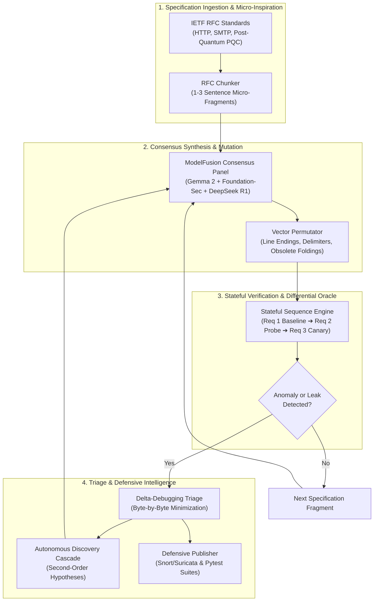

<div align="center">

```text
  ____  _____ ____   _   _ _   _ _   _ _____ 
 |  _ \|  ___/ ___| | | | | | | | \ | |_   _|
 | |_) | |_ | |     | |_| | | | |  \| | | |  
 |  _ <|  _|| |___  |  _  | |_| | |\  | | |  
 |_| \_\_|   \____| |_| |_|\___/|_| \_| |_|  
  Autonomous Protocol Research & Ruler Engine
```

# RFC Hunt Swarm & Protocol Ruler
### Specification-Driven Autonomous Protocol Research Factory & Differential Buffer Ruler

[](https://www.python.org/)
[](https://github.com/langchain-ai/langgraph)
[](https://ollama.ai/)
[](https://portswigger.net/research/can-ai-do-novel-security-research)
[](LICENSE)

> [!IMPORTANT]
> **Inspired by James Kettle's Seminal Research ([Can AI Do Novel Security Research?](https://portswigger.net/research/can-ai-do-novel-security-research))**:
> An autonomous, 12-agent research swarm orchestrated via LangGraph that extracts normative grammar rules and micro-inspiration from Post-Quantum Cryptography (PQC) and IETF RFC specifications, synthesizes novel boundary and desynchronization probes via ModelFusion, executes stateful pipelined canary sequences against live HTTP/TLS endpoints, and delta-debugs reproducible anomalies.

</div>

---

## Table of Contents
1. [Overview & Core Architecture](#overview--core-architecture)
2. [The Protocol Ruler Technique](#the-protocol-ruler-technique)
3. [Interactive Mission Control Dashboard](#interactive-mission-control-dashboard)
4. [Installation & Setup](#installation--setup)
5. [Swarm Execution Modes & Workflows](#swarm-execution-modes--workflows)
6. [Exhaustive CLI Flag & Parameter Reference](#exhaustive-cli-flag--parameter-reference)
   - [rfc_hunt_swarm.py (Swarm CLI)](#1-rfc_hunt_swarmpy-swarm-orchestrator)
   - [protocol_ruler.py (Standalone Ruler)](#2-protocol_rulerpy-standalone-ruler)
   - [main.py (Modular Subcommand Toolkit)](#3-mainpy-modular-toolkit-subcommands)
7. [The 12 Protocol Research Modules](#the-12-protocol-research-modules)
8. [Research Attribution & Citations](#research-attribution--citations)

---

## Overview & Core Architecture

Traditional fuzzer and LLM security audits fail on network protocols because they suffer from **context-contamination** and **over-anchoring**—asking generic questions like *"find request smuggling bugs"* yields 0% novelty because models hallucinate known, trivial exploits.

**RFC Hunt Swarm** solves this using James Kettle's micro-inspiration discipline:



1. **Micro-Inspiration Engine**: Normative RFC specifications are split into isolated 1–3 sentence grammatical clues. Zero buzzwords (*"desync"*, *"smuggling"*) are used in prompts, forcing models to derive state-machine anomalies from first principles.
2. **ModelFusion Consensus Panel**: Runs 100% locally via Ollama without cloud token costs:
   - **Protocol Specialist**: `gemma2:2b`
   - **Exploit Boundary Specialist**: `fenkohq/foundation-sec-8b:latest` (or `qwen2.5:7b`)
   - **Reasoning Arbiter**: `deepseek-r1:1.5b`
3. **3-Step Canary Evaluation Primitive**: Probes persistent TCP connections directly:
   - **REQ 1**: Baseline measurement on clean socket channel.
   - **REQ 2**: Attacker probe with canary marker or trailing boundary bytes.
   - **REQ 3**: Pipelined canary request to detect cross-connection / pipeline state contamination.
4. **Autonomous Discovery Cascade**: Confirmed vulnerabilities are automatically generalized into second-order hypotheses (e.g. *Shared-Parser Confusion*, *Response Forking*, *Dangling-Byte Queue Poisoning*).

---

## The Protocol Ruler Technique

Invented by James Kettle as a benchmark to test whether AI could invent novel security research methods, the **Protocol Ruler** technique measures front-end transformations without needing header reflection in response bodies.

### The Physical Principle
Almost all web servers enforce a strict header buffer length limit (e.g. 64,040 bytes). Exceeding it by even 1 byte triggers a `400 Bad Request` or `431 Request Header Fields Too Large`. When a front-end server or reverse proxy modifies, normalizes, or rewrites input, the byte sequence length changes.

By positioning header padding right on the cusp of the limit, the backend's buffer acts like a **physical micrometer**:

$$\Delta = L_{\text{baseline}} - L_{\text{mutated}}$$

```text
======================================================================
[+] PROTOCOL RULER CALIBRATED: Header Length Limit = 64,040 bytes
======================================================================
GET / HTTP/1.1
Host: target.local
A: AAA...{64040} -> 200 OK (29.8ms)
A: AAA...{64041} -> 400 Bad Request (16.0ms)
======================================================================

--- [RULER MEASUREMENT] Kettle Overlong UTF-8 (c0 8a) ---
  Sequence         : b'\xc0\x8a' (2 bytes)
  Mutated Limit    : 64,030 bytes (Baseline: 64,040)
  Delta            : +10 bytes
  Behavior         : EXPANDED by 10 bytes on front-end!
  Trace Cliff      :
    A: \xc0\x8a A...{64030} -> 200 OK
    A: \xc0\x8a A...{64031} -> 400 Bad Request
```

### Interpretation Matrix
- **$\Delta > 0$ (Expansion)**: The front-end expanded the sequence by $\Delta$ bytes (e.g. UTF-8 decoding, WAF escaping, IP-spoofing injection).
- **$\Delta < 0$ (Contraction)**: The front-end stripped or normalized the sequence by $|\Delta|$ bytes (e.g. header dropped, whitespace collapsed).
- **$\Delta = 0$ (Verbatim)**: Passed through untouched.

### Built-in Transformation Test Suite
| Probe Name | Raw Bytes | Category | Purpose |
| :--- | :--- | :--- | :--- |
| **Kettle Overlong UTF-8** | `\xc0\x8a` | UTF-8 Overlong | Detects front-end UTF-8 expansion / mojibake. |
| **Overlong Slash (2-byte)** | `\xc0\xaf` | Normalization | Tests path-traversal decoding before backend arrival. |
| **Overlong Slash (3-byte)** | `\xe0\x80\xaf` | Normalization | Tests gateway multi-byte expansion. |
| **Overlong Slash (4-byte)** | `\xf0\x80\x80\xaf` | Normalization | Tests 4-byte UTF-8 handling. |
| **Unicode Kelvin Sign** | `\xe2\x84\xaa` | NFKC Normalization | $U+212A$ normalizes to ASCII `K` (3 bytes $\rightarrow$ 1 byte). |
| **Unicode Ligature fi** | `\xef\xac\x81` | NFKD Normalization | $U+FB01$ normalizes to `fi` (3 bytes $\rightarrow$ 2 bytes). |
| **Non-Breaking Space** | `\xc2\xa0` | Whitespace | $U+00A0$ normalization to standard `0x20` space. |
| **Fullwidth Solidus** | `\xef\xbc\x8f` | Normalization | $U+FF0F$ fullwidth `/` conversion to standard `/`. |
| **Line Folding Space** | `\r\n ` | RFC 7230 | Tests if proxy collapses CRLF+space into a single space. |
| **Line Folding Tab** | `\r\n\t` | RFC 7230 | Tests horizontal tab whitespace handling. |
| **IP Spoofing (XFF)** | `X-Forwarded-For: 127.0.0.1\r\n` | Header Injection | Measures whether proxy strips or appends client IP. |
| **IP Spoofing (X-Real-IP)**| `X-Real-IP: 127.0.0.1\r\n` | Header Injection | Measures internal IP header overwriting. |
| **Null Byte** | `\x00` | Truncation | Tests C-string null termination in reverse proxies. |
| **Vertical Tab** | `\x0b` | Whitespace | Tests sanitization stripping of control characters. |
| **Escaped Quote** | `\"` | WAF Escaping | Tests backslash stripping or quote-escaping logic. |

---

## Interactive Mission Control Dashboard

The repository includes a standalone **Generative UI** mission control panel:
- Open `rfchunt_dashboard.html` in any browser or in the IDE side pane.
- **Interactive Command Generator**: Real-time terminal command builder with one-click copy.
- **Live Protocol Ruler Simulator**: Interactive slider showing the 64,040-byte buffer cliff and live transformation deltas.
- **Searchable Flag Filter**: Instant search across all CLI flags and parameters.

---

## Installation & Setup

### Prerequisites
- Python 3.10+
- Local [Ollama](https://ollama.ai/) daemon running on `http://127.0.0.1:11434`
- Pull resident local models:
  ```bash
  ollama pull gemma2:2b
  ollama pull deepseek-r1:1.5b
  ollama pull qwen2.5:7b
  # Optional high-precision security model:
  # ollama pull fenkohq/foundation-sec-8b:latest
  ```

### Install Dependencies
```bash
git clone https://github.com/oyesanyf/rfchunt.git
cd rfchunt
pip install -r requirements.txt
```

---

## Swarm Execution Modes & Workflows

### 1. Protocol Ruler Mode (Buffer Boundary Measurement)
```bash
# Calibrate backend limits and measure 15 transformations against local target
python -u rfc_hunt_swarm.py --mode ruler --host 127.0.0.1 --port 8080 --debug

# Run against remote HTTPS target
python -u rfc_hunt_swarm.py --mode ruler --host staging.corp.internal --port 443 --tls
```

### 2. Post-Quantum Cryptography (PQC) & Hybrid TLS Corpus
```bash
# Researches ML-KEM, HPKE, & Quantum-Resistant TLS specifications (RFCs 10042, 9180, 9370, etc.)
python -u rfc_hunt_swarm.py --mode pqc --host test-lab.internal --port 443 --tls --debug
```

### 3. James Kettle Curated Corpus (138 core HTTP/SMTP RFCs)
```bash
# Full swarm evaluation across Kettle's curated specification corpus
python -u rfc_hunt_swarm.py --mode corpus --host 127.0.0.1 --port 8080 --cycles 5
```

### 4. Focused Single RFC Analysis
```bash
# Target RFC 9112 (HTTP/1.1) or RFC 7230
python -u rfc_hunt_swarm.py --mode single --rfc 9112 --host 127.0.0.1 --port 8080 --debug
```

### 5. HTTP Terminator & Intermediary Research (Curated RFC Suite)

The HTTP Terminator research specifically tests how front-end reverse proxies, TLS terminators, and API gateways interpret request boundaries compared to back-end origin servers.

#### Targeted Terminator RFC Specifications
```bash
# 1. Primary Line Terminator & Framing Spec (RFC 9112 - CRLF/LF leniency, chunked framing, obs-fold):
python -u rfc_hunt_swarm.py --mode single --rfc 9112 --host target.example.com --port 443 --tls --debug

# 2. Predecessor Standard (RFC 7230 - standard used by AWS ALB, Nginx, Envoy, Cloudflare):
python -u rfc_hunt_swarm.py --mode single --rfc 7230 --host target.example.com --port 443 --tls --debug

# 3. HTTP Semantics & Intermediaries (RFC 9110 - Gateways, hop-by-hop headers, Connection handling):
python -u rfc_hunt_swarm.py --mode single --rfc 9110 --host target.example.com --port 443 --tls --debug

# 4. Historic Baseline & Tolerances (RFC 2616 - Multipart/byteranges & line folding):
python -u rfc_hunt_swarm.py --mode single --rfc 2616 --host target.example.com --port 443 --tls --debug

# 5. HTTP/2 Gateway Translation (RFC 9113 Section 8 - H2.CL / H2.TE desynchronization):
python -u rfc_hunt_swarm.py --mode single --rfc 9113 --host target.example.com --port 443 --tls --debug

# 6. TLS 1.3 Terminator (RFC 8446 - TLS handshakes, ALPN negotiation, early data):
python -u rfc_hunt_swarm.py --mode single --rfc 8446 --host target.example.com --port 443 --tls --debug

# 7. URI Generic Syntax (RFC 3986 - Path normalization & NUL-byte truncation):
python -u rfc_hunt_swarm.py --mode single --rfc 3986 --host target.example.com --port 443 --tls --debug
```

#### Run the Entire Curated Terminator RFC Suite in Rank Order
```bash
# Cycles automatically through RFC 9112, 9110, 7230, 2616, 9113, 7540, 9114, 8446:
python -u rfc_hunt_swarm.py --mode terminator --host target.example.com --port 443 --tls --debug
```

#### Target Other Front-End / Reverse Proxy Terminators
You can target any intermediary or load balancer tier simply by changing `--host` and `--port`:
```bash
# Target an AWS Application Load Balancer / CloudFront distribution:
python -u rfc_hunt_swarm.py --mode single --rfc 9112 --host staging-alb.example.com --port 443 --tls --debug

# Target an internal Nginx / HAProxy / Envoy ingress proxy:
python -u rfc_hunt_swarm.py --mode single --rfc 9112 --host proxy.corp.internal --port 80 --debug

# Target an IP address directly:
python -u rfc_hunt_swarm.py --mode single --rfc 9112 --host 10.0.1.50 --port 80 --debug
```

### 6. Unified 'Build All' Pipeline

Builds, compiles, pre-caches all 11 Terminator RFCs for offline execution, exports the Caldera plugin, verifies Dream-RSI models, runs the test suite, and packages release zips:
```bash
# Run full automated build:
python build_all.py
# Or via Windows batch launcher:
.\build.bat
# Or via main CLI:
python main.py build

# Quick build (skips running the test suite):
python main.py build --skip-tests
```

### 7. High-Speed Scanning with Fast Security Specialist
```bash
# Uses qwen2.5:7b for fast local evaluation with 5-minute timeout
python -u rfc_hunt_swarm.py --mode corpus --sec-model qwen2.5:7b --timeout 300
```

---

## Exhaustive CLI Flag & Parameter Reference

### 1. `rfc_hunt_swarm.py` (Swarm Orchestrator)

The main entrypoint executing the 12-agent LangGraph autonomous research swarm.

| Flag / Argument | Type | Default | Description & Engineering Details |
| :--- | :--- | :--- | :--- |
| `--mode` | `choice` | `single` | Scan mode: `single` (one RFC), `terminator` (curated HTTP Terminator suite), `corpus` (Kettle 138 corpus), `all` (IETF registry), `pqc` (Post-Quantum & TLS 1.3), or `ruler` (Protocol Ruler). |
| `--rfc` | `string` | `9112` | Target RFC number when `--mode single` is selected. Automatically normalizes inputs (e.g. `RFC9112` $\rightarrow$ `9112`). |
| `--host` | `string` | `127.0.0.1` | Target IP address or hostname. Dynamically normalizes `Host: target.local` probes to the real target to prevent gateway rejection. |
| `--port` | `integer` | `5006` | Target TCP port. If port `443` is specified, TLS is automatically enabled. |
| `--tls` | `flag` | `False` | Wraps socket in TLS/HTTPS context with SNI and self-signed certificate tolerance. |
| `--cycles` | `integer` | `3` | Maximum mutation and permutation cycles executed per RFC. |
| `--timeout` | `float` | `900.0` | Process-scoped Ollama inference timeout in seconds (900s = 15m). Set to `0` for unlimited timeout on heavy models. |
| `--sec-model` | `string` | `None` | Secondary security model for ModelFusion (e.g. `qwen2.5:7b`, `fenkohq/foundation-sec-8b:latest`, `deepseek-r1:1.5b`). |
| `--debug` | `flag` | `False` | Enables James Kettle evaluation trace printing: socket status, `[REQ 1]` baseline, `[REQ 2]` probe, `[REQ 3]` canary, and compressed wire bytes. |
| `--show-response`| `flag` | `False` | Prints sanitized host response status lines and protocol headers (`Server`, `Content-Type`, `Connection`) while filtering HTML noise. |
| `-v`, `--verbose`| `flag` | `False` | Enables full verbose telemetry, showing raw unsanitized response bodies and socket pipeline metrics. |

---

### 2. `protocol_ruler.py` (Standalone Ruler)

Standalone CLI dedicated exclusively to buffer boundary calibration and byte transformation measurement.

| Flag / Argument | Type | Default | Description & Engineering Details |
| :--- | :--- | :--- | :--- |
| `--host` | `string` | `127.0.0.1` | Target IP address or hostname. |
| `--port` | `integer` | `8080` | Target TCP port. |
| `--tls` | `flag` | `False` | Enables TLS encryption. |
| `--max-size` | `integer` | `131072` | Ceiling in bytes for coarse bracket search when calibrating backend limits (128 KB). |
| `--timeout` | `float` | `3.5` | Socket read/write timeout in seconds for boundary probes. |
| `--sequence` | `string` | `None` | Custom byte sequence to measure (e.g. `\xc0\x8a`, hex `c08a`, or string literals). |
| `--name` | `string` | `Custom Probe`| Human-readable label for custom sequences tested via `--sequence`. |
| `--debug` | `flag` | `False` | Enables step-by-step bracket and binary search tracing down to single-byte resolution. |
| `-v`, `--verbose`| `flag` | `False` | Displays detailed status outputs. |

---

### 3. `main.py` (Modular Toolkit Subcommands)

Modular toolkit providing discrete CLI commands for each phase of the research factory.

#### Global Options
| Flag | Type | Default | Description |
| :--- | :--- | :--- | :--- |
| `--db` | `string` | `terminator.db` | SQLite database file for persisting findings and states. |
| `--model` | `string` | `gemma2:2b` | Primary base LLM model for micro-inspiration generation. |
| `--no-fusion` | `flag` | `False` | Disables multi-model consensus panel, running single generator model only. |

#### Subcommands
- **`main.py ruler`**: Executes Protocol Ruler measurement.
  - Options: `--target`, `--port`, `--tls`, `--timeout`, `--max-size`, `--sequence`, `--name`, `--debug`, `-v`.
- **`main.py hunt`**: Runs continuous flaw hunter across RFCs until vulnerabilities are confirmed.
  - Options: `--target`, `--port`, `--tls`, `--max-rfcs`, `--fragments`, `--variants`, `--keep-going`.
- **`main.py fetch`**: Downloads normative RFC specifications from the IETF registry.
  - Options: `--count`, `--cache-dir`, `--discover-recent`.
- **`main.py chunk`**: Chunks downloaded RFCs into micro-inspiration fragments.
  - Options: `--sentences` (sentences per chunk, default: 2).
- **`main.py generate`**: Synthesizes raw candidate HTTP probes from stored fragments.
  - Options: `--limit` (number of fragments to process).
- **`main.py permute`**: Generates combinatorial variants of base probes.
  - Options: `--limit`, `--variants` (variants per probe, default: 3).
- **`main.py evaluate`**: Executes deterministic 3-step evaluation harness on pending probes.
  - Options: `--target`, `--port`, `--tls`, `--timeout`, `--limit`.
- **`main.py weaponize`**: Evaluates Dangling-Byte Request Queue Poisoning vectors.
  - Options: `--target`, `--port`, `--tls`.
- **`main.py cascade`**: Formulates second-order hypotheses from confirmed findings.
  - Options: `--demo` (runs demonstration finding if none confirmed yet).
- **`main.py lab`**: Starts local test lab server with simulated 64,040-byte limit and desync triggers.
  - Options: `--host`, `--port`.
- **`main.py auto`**: Runs the complete end-to-end autonomous research loop continuously.
- **`main.py mcp`**: Launches Model Context Protocol (MCP) server over stdio for IDE integration.

---

## The 12 Protocol Research Modules

| # | Module | Source File | Core Responsibility |
| :-: | :--- | :--- | :--- |
| **1** | **ABNF Grammar Extractor** | `engine/abnf_engine.py` | Compiles formal RFC 5234 ABNF grammar rules to find boundary edge-cases. |
| **2** | **Context-Free Generator** | `probe_generator.py` | Synthesizes unanchored HTTP request templates from isolated micro-fragments. |
| **3** | **Semantic Constraint Compiler** | `engine/semantic_compiler.py` | Extracts normative RFC keywords (`MUST`, `SHOULD NOT`) into validation rules. |
| **4** | **Differential Oracle** | `engine/differential_oracle.py`| Dispatches probes across multi-engine targets to detect metamorphic divergences. |
| **5** | **Stateful Sequence Engine** | `engine/sequence_engine.py` | Manages persistent TCP channels to test 3-step canary contamination. |
| **6** | **RFC Evolution Tracker** | `engine/errata_tracker.py` | Tracks official IETF technical errata and historical specification updates. |
| **7** | **Metamorphic Invariance Oracle** | `engine/metamorphic_engine.py`| Tests semantic equivalence across case, whitespace, and encoding mutations. |
| **8** | **Delta-Debugging Engine** | `engine/delta_debugger.py` | Recursively slices payloads to isolate the absolute minimal root-cause byte sequence. |
| **9** | **Causal Anomaly Classifier** | `engine/causal_classifier.py` | Classifies anomalies into discrete taxonomy (CL.0, TE.CL, Response Forking, Leaks). |
| **10**| **Cross-Protocol Analyzer** | `engine/boundary_analyzer.py`| Translates SMTP/MIME delimiters and BDAT frames into HTTP parser confusion probes. |
| **11**| **Research Knowledge Graph** | `engine/knowledge_graph.py` | Maintains an interconnected SQLite knowledge graph of RFCs, rules, and findings. |
| **12**| **Defensive Publisher** | `engine/defensive_publisher.py`| Exports Snort/Suricata rules (Arm 106) and pytest regression suites (Arm 107). |

---

## Research Attribution & Citations

This project was inspired by James Kettle's research ([Can AI Do Novel Security Research?](https://portswigger.net/research/can-ai-do-novel-security-research), October 2026):
> *An autonomous, 12-agent research swarm orchestrated via LangGraph that extracts normative grammar rules and micro-inspiration from Post-Quantum Cryptography (PQC) and IETF RFC specifications, synthesizes novel boundary and desynchronization probes via ModelFusion, executes stateful pipelined canary sequences against live HTTP/TLS endpoints, and delta-debugs reproducible anomalies.*

- **Seminal Research Paper**: [Can AI Do Novel Security Research?](https://portswigger.net/research/can-ai-do-novel-security-research) (PortSwigger Research, October 2026)
- **Author**: James Kettle ([@albinowax](https://x.com/albinowax) / [jameskettle.com](https://jameskettle.com/))
- **Reference Tool**: [HTTP Terminator (GitHub)](https://github.com/portswigger/http-terminator)

### Key Methodologies Implemented:
1. **Micro-Inspiration Prompts**: Preventing context-contamination by feeding isolated 1–3 sentence RFC fragments.
2. **Persistent Socket Canaries**: Proving real state contamination through 3-step connection sequences.
---

## RAPTOR Framework Integration & Attribution

The RFC Hunt Swarm seamlessly integrates the **RAPTOR Autonomous Offensive/Defensive Research Framework** to bridge wire-level protocol desynchronization research with source-code static analysis and dynamic web application security testing.

### Credit & Attribution:
- **Project**: [RAPTOR: Autonomous Offensive/Defensive Research Framework](https://github.com/gadievron/raptor)
- **Core Authors**:
  - **Gadi Evron**
  - **Daniel Cuthbert** ([ORCID: 0009-0000-6443-0251](https://orcid.org/0009-0000-6443-0251))
  - **Thomas Dullien ("Halvar Flake")**
- **Docker Engine**: `danielcuthbert/raptor:latest`
- **Citation**:
  ```bibtex
  @software{Evron_RAPTOR_2026,
    author = {Evron, Gadi and Cuthbert, Daniel and Dullien, Thomas},
    title = {{RAPTOR: Autonomous Offensive/Defensive Research Framework}},
    url = {https://github.com/gadievron/raptor},
    version = {3.1.0},
    year = {2026}
  }
  ```

### Key Integration Capabilities:
1. **Live Host Dynamic Web Application Security Testing (`raptor.py web`)**:
   - Executes phased DAST discovery, ASVS checks, parameter fuzzing, and injection checks against live remote target hosts (`--host target.example.com --port 443 --tls`).
2. **Autonomous Source Code Security Audits (`scan`, `agentic`, `crypto`, `sca`)**:
   - Runs Semgrep, Coccinelle, and CodeQL against web server repositories and backend implementations.
   - Evaluates exploitability via local Ollama models (`fenkohq/foundation-sec-8b:latest`).
3. **Unified Vulnerability Ledger (`terminator.db`)**:
   - Automatically ingests SARIF findings and correlates wire-level RFC desync anomalies with underlying source code defects.

### CLI Usage:
```bash
# 1. Check RAPTOR Docker container and Ollama security model status
python -u rfc_hunt_swarm.py raptor --status

# 2. Run RAPTOR Web Application scan against a live remote host
python -u rfc_hunt_swarm.py raptor --host vanguardngr.com --port 443 --tls

# 3. Run full agentic source code audit on a local target repository
python -u rfc_hunt_swarm.py raptor --repo D:\path\to\target --raptor-mode agentic

# 4. Run post-quantum cryptography (PQC) readiness audit
python -u rfc_hunt_swarm.py raptor --repo D:\path\to\target --raptor-mode crypto

# 5. Review all discovered SARIF vulnerability findings
python -u rfc_hunt_swarm.py raptor --findings
```

---

## License

Apache 2.0 / MIT.
