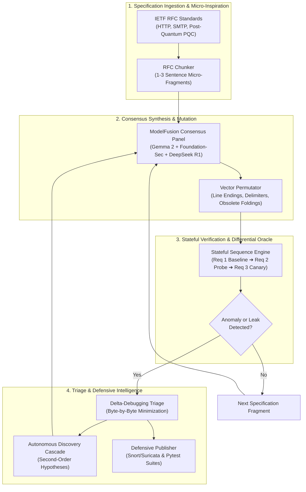

<div align="center">

```text
  ____  _____ ____   _   _ _   _ _   _ _____ 
 |  _ \|  ___/ ___| | | | | | | | \ | |_   _|
 | |_) | |_ | |     | |_| | | | |  \| | | |  
 |  _ <|  _|| |___  |  _  | |_| | |\  | | |  
 |_| \_\_|   \____| |_| |_|\___/|_| \_| |_|  
  Autonomous Protocol Research & Ruler Engine
```

# RFC Hunt Swarm & Protocol Ruler
### Specification-Driven Autonomous Protocol Research Factory & Differential Buffer Ruler

[](https://www.python.org/)
[](https://github.com/langchain-ai/langgraph)
[](https://ollama.ai/)
[](https://portswigger.net/research/can-ai-do-novel-security-research)
[](https://github.com/google-research/harness2)
[](LICENSE)

> [!IMPORTANT]
> **Inspired by James Kettle's Seminal Research ([Can AI Do Novel Security Research?](https://portswigger.net/research/can-ai-do-novel-security-research)) & Google Research's [Harness²](https://github.com/google-research/harness2)**:
> An autonomous, 16-module research swarm orchestrated via LangGraph that extracts normative grammar rules and micro-inspiration from Post-Quantum Cryptography (PQC) and IETF RFC specifications, recursively refines its 8-component agent harness (`c1..c8`) via Harness², synthesizes novel boundary and desynchronization probes via ModelFusion, executes stateful pipelined canary sequences against live HTTP/TLS endpoints, and delta-debugs reproducible anomalies.

</div>

---

## Table of Contents
1. [Master Scorecard: Standalone Tools vs. RFCHunt (`--all`)](#master-scorecard-standalone-tools-vs-rfchunt---all)
2. [Overview & Core Architecture](#overview--core-architecture)
3. [The Protocol Ruler Technique](#the-protocol-ruler-technique)
4. [Interactive Mission Control Dashboard](#interactive-mission-control-dashboard)
5. [Installation & Setup](#installation--setup)
6. [Swarm Execution Modes & Workflows](#swarm-execution-modes--workflows)
7. [Exhaustive CLI Flag & Parameter Reference](#exhaustive-cli-flag--parameter-reference)
   - [rfc_hunt_swarm.py (Swarm CLI)](#1-rfc_hunt_swarmpy-swarm-orchestrator)
   - [protocol_ruler.py (Standalone Ruler)](#2-protocol_rulerpy-standalone-ruler)
   - [main.py (Modular Subcommand Toolkit)](#3-mainpy-modular-toolkit-subcommands)
8. [The 19 Protocol Research Modules](#the-16-protocol-research-modules)
9. [Research Attribution & Citations](#research-attribution--citations)
10. [RAPTOR Framework Integration & Attribution](#raptor-framework-integration--attribution)
11. [Google Research Harness² Integration & Attribution](#google-research-harness-integration--attribution)
12. [Abliterated Models & Refusal-Free ModelFusion Guide](docs/ABLITERATED_MODELS_AND_FUSION_GUIDE.md)
13. [Full Capability Matrix & Operational Rigor Specification](docs/MASTER_SCORECARD.md)
14. [HackerOne QA Phase, Cooldown Readiness & Autonomous Headless Hunting](#hackerone-qa-phase-cooldown-readiness--autonomous-headless-hunting)
15. [ACDSO-Adapted ML HackerOne Program Selection, Diff Ranking & Recon Clustering](#acdso-adapted-ml-hackerone-program-selection-diff-ranking--recon-clustering)
16. [Global Windows ConPTY Deadlock Cleaner & Watchdog](#global-windows-conpty-deadlock-cleaner--watchdog)

---

## Master Scorecard: Standalone Tools vs. RFCHunt (`--all`)

RFCHunt unifies deep RFC protocol research, white-box AST/verification-inversion auditing, AI/MCP supply-chain defense, live differential verification, and self-hosted full-lifecycle GUI orchestration — with **default-on Strict 3-Lane Evidence Separation** so speculative passive correlations never dilute deterministic static signal or inflate severity.

| Capability | `aiscan` alone | `RAPTOR` alone | `ARTEX` alone | `Mantis` alone | `Smuggler` / `Nuclei` alone | **RFCHunt (`--all` + `--serve-ui`)** |
| :--- | :---: | :---: | :---: | :---: | :---: | :--- |
| **AI / Prompt / MCP Poisoning & Unicode Smuggling** | Yes | Partial | No | Partial | No | **Yes (Native + Rust + Unicode BiDi/Tag + MCP Shadowing + Polyglot Routes)** |
| **SAST + PQC Crypto Readiness + Multi-Ecosystem SCA** | No | Yes | No | Partial | No | **Yes (Native + Docker RAPTOR + NIST FIPS 203/204/205 Score + CVE Range SCA)** |
| **6-Pass Verification Inversion Hunting** | No | No | No | No | No | **Yes (`0` FP on `sandbox-runtime`, Formal Invariants + Witness Traces)** |
| **Live 30-Day CVE + ArXiv AST Rule Compiler** | No | No | No | No | No | **Yes (5 Structural Templates + Python AST Def-Use Taint + 3-Way Self-Test Gate)** |
| **Enterprise-Safe Live Proxy Smuggling Fuzz** | No | No | No | No | Partial (Unsafe) | **Yes (`--allow-repo-exec` Opt-In + Env-Scrubbed + Ephemeral Sink Telemetry)** |
| **Dual-Graph Multi-Hop Chaining + POE** | No | No | Yes | No | No | **Yes (Cross-Layer Wire + Code + AI + Default 3-Lane Isolation)** |
| **4-Parser Differential Oracle + Merkle Proof** | No | No | No | No | No | **Yes (RFC 6962 Verified + Signed Tree Head + Consistency Proofs)** |
| **Auto-Generated Patch + Snort 3 / Nuclei / Caldera** | No | Partial | No | Prompt only | No | **Yes (Verified-Only Gate: AST Patches + Snort 3 + Nuclei YAML + Caldera)** |
| **Self-Hosted Full-Lifecycle GUI & Network Orchestration** | No | No | Yes | No | No | **Yes (`--serve-ui` Loopback SPA + Authenticated REST/SSE + `--network-lifecycle`)** |

> [!TIP]
> **Operational Rigor by Default (Zero Severity Inflation)**:
> Running `python rfc_hunt_swarm.py --all <target>` strictly isolates findings into **3 orthogonal evidence lanes**:
> 1. **Lane 1 (`VERIFIED_EXPLOIT`, `poe_level == 3`)** — Live/runtime/container-verified exploits (the only lane eligible to write RFC 6962 Merkle differential leaves and Snort 3 / Nuclei defensive rules).
> 2. **Lane 2 (`DETERMINISTIC_STATIC`)** — Deterministic AST, Verification-Inversion, self-tested structural detectors, SAST/PQC/SCA, and AI/MCP checks (`combined_report.sarif` and headline `severity_counts` contain strictly **Lane 1 + Lane 2**).
> 3. **Lane 3 (`SPECULATIVE_HYPOTHESIS`, `poe_level <= 1`)** — Unverified multi-hop Dual-Graph chains and synthesized probe templates are isolated into `speculative_hypotheses.sarif` (`level: "note"`, severity capped at `LOW`/`INFO` with theoretical blast radius preserved under `potential_impact`).
>
> See [docs/MASTER_SCORECARD.md](docs/MASTER_SCORECARD.md) for the complete architecture, verification metrics, and `--serve-ui` Mission Control guide.

---

## Overview & Core Architecture

Traditional fuzzer and LLM security audits fail on network protocols because they suffer from **context-contamination** and **over-anchoring**—asking generic questions like *"find request smuggling bugs"* yields 0% novelty because models hallucinate known, trivial exploits.

**RFC Hunt Swarm** solves this using James Kettle's micro-inspiration discipline:



1. **Micro-Inspiration Engine**: Normative RFC specifications are split into isolated 1–3 sentence grammatical clues. Zero buzzwords (*"desync"*, *"smuggling"*) are used in prompts, forcing models to derive state-machine anomalies from first principles.
2. **ModelFusion Consensus Panel**: Runs 100% locally via Ollama without cloud token costs:
   - **Protocol Specialist (Abliterated Gemma)**: `hf.co/OBLITERATUS/Gemma-4-12B-OBLITERATED:Q4_K_M` (default primary model; refusal-direction ablated with zero safety alignment/refusal guardrails).
   - **Exploit Boundary Specialist (Cisco Foundation-Sec)**: `huihui_ai/foundation-sec-abliterated:8b` (prioritized if installed) or Cisco `fenkohq/foundation-sec-8b:latest` (installed default).
   - **Adversarial Reasoning Arbiter (GLM-4)**: `huihui_ai/glm-4.7-abliterated` (prioritized if installed) or `glm4:9b` / `glm-4.7-flash:latest` (installed default; falls back to `deepseek-r1:1.5b` if no GLM tag is installed).
3. **Refusal-Free Abliterated Execution by Default (No Safety Guardrails)**:
   > **Notice**: **Abliterated, refusal-free models are enabled BY DEFAULT (`--abliteration` defaults to `True`) across the entire `rfchunt` codebase** (CLI, `main.py`, `rfc_hunt_swarm.py`, `start.py`, MCP tools, and Module 20). There are **no AI safety refusal filters or alignment censors** gating raw exploit, smuggling, or PoC generation. Operate strictly against authorized targets and isolated lab environments.
   - Refusal-direction ablated models (`failspy` orthogonal projection method) are natively supported across RFC probe generation, Protocol Ruler differential fuzzing, and RAPTOR agentic source code triage.
   - **`hf.co/OBLITERATUS/Gemma-4-12B-OBLITERATED:Q4_K_M`**, Cisco **`fenkohq/foundation-sec-8b:latest`**, and **`glm4:9b`** form the default ModelFusion trio (automatically upgrading to abliterated Cisco/GLM tags such as `huihui_ai/foundation-sec-abliterated:8b` or `huihui_ai/glm-4.7-abliterated` when pulled in Ollama).
   - Enabled out-of-the-box (`--abliteration` default: `True`).
   - Automatically detected and prioritized across `ModelFusionAdapter` and `FusionArbiter` with automated **Refusal Rescue**.
   - See the comprehensive [Abliterated Models & ModelFusion Refusal-Free Arbitration Guide](docs/ABLITERATED_MODELS_AND_FUSION_GUIDE.md).
4. **3-Step Canary Evaluation Primitive**: Probes persistent TCP connections directly:
   - **REQ 1**: Baseline measurement on clean socket channel.
   - **REQ 2**: Attacker probe with canary marker or trailing boundary bytes.
   - **REQ 3**: Pipelined canary request to detect cross-connection / pipeline state contamination.
5. **Autonomous Discovery Cascade**: Confirmed vulnerabilities are automatically generalized into second-order hypotheses (e.g. *Shared-Parser Confusion*, *Response Forking*, *Dangling-Byte Queue Poisoning*).

---

## The Protocol Ruler Technique

Invented by James Kettle as a benchmark to test whether AI could invent novel security research methods, the **Protocol Ruler** technique measures front-end transformations without needing header reflection in response bodies.

### The Physical Principle
Almost all web servers enforce a strict header buffer length limit (e.g. 64,040 bytes). Exceeding it by even 1 byte triggers a `400 Bad Request` or `431 Request Header Fields Too Large`. When a front-end server or reverse proxy modifies, normalizes, or rewrites input, the byte sequence length changes.

By positioning header padding right on the cusp of the limit, the backend's buffer acts like a **physical micrometer**:

$$\Delta = L_{\text{baseline}} - L_{\text{mutated}}$$

```text
======================================================================
[+] PROTOCOL RULER CALIBRATED: Header Length Limit = 64,040 bytes
======================================================================
GET / HTTP/1.1
Host: target.local
A: AAA...{64040} -> 200 OK (29.8ms)
A: AAA...{64041} -> 400 Bad Request (16.0ms)
======================================================================

--- [RULER MEASUREMENT] Kettle Overlong UTF-8 (c0 8a) ---
  Sequence         : b'\xc0\x8a' (2 bytes)
  Mutated Limit    : 64,030 bytes (Baseline: 64,040)
  Delta            : +10 bytes
  Behavior         : EXPANDED by 10 bytes on front-end!
  Trace Cliff      :
    A: \xc0\x8a A...{64030} -> 200 OK
    A: \xc0\x8a A...{64031} -> 400 Bad Request
```

### Interpretation Matrix
- **$\Delta > 0$ (Expansion)**: The front-end expanded the sequence by $\Delta$ bytes (e.g. UTF-8 decoding, WAF escaping, IP-spoofing injection).
- **$\Delta < 0$ (Contraction)**: The front-end stripped or normalized the sequence by $|\Delta|$ bytes (e.g. header dropped, whitespace collapsed).
- **$\Delta = 0$ (Verbatim)**: Passed through untouched.

### Built-in Transformation Test Suite
| Probe Name | Raw Bytes | Category | Purpose |
| :--- | :--- | :--- | :--- |
| **Kettle Overlong UTF-8** | `\xc0\x8a` | UTF-8 Overlong | Detects front-end UTF-8 expansion / mojibake. |
| **Overlong Slash (2-byte)** | `\xc0\xaf` | Normalization | Tests path-traversal decoding before backend arrival. |
| **Overlong Slash (3-byte)** | `\xe0\x80\xaf` | Normalization | Tests gateway multi-byte expansion. |
| **Overlong Slash (4-byte)** | `\xf0\x80\x80\xaf` | Normalization | Tests 4-byte UTF-8 handling. |
| **Unicode Kelvin Sign** | `\xe2\x84\xaa` | NFKC Normalization | $U+212A$ normalizes to ASCII `K` (3 bytes $\rightarrow$ 1 byte). |
| **Unicode Ligature fi** | `\xef\xac\x81` | NFKD Normalization | $U+FB01$ normalizes to `fi` (3 bytes $\rightarrow$ 2 bytes). |
| **Non-Breaking Space** | `\xc2\xa0` | Whitespace | $U+00A0$ normalization to standard `0x20` space. |
| **Fullwidth Solidus** | `\xef\xbc\x8f` | Normalization | $U+FF0F$ fullwidth `/` conversion to standard `/`. |
| **Line Folding Space** | `\r\n ` | RFC 7230 | Tests if proxy collapses CRLF+space into a single space. |
| **Line Folding Tab** | `\r\n\t` | RFC 7230 | Tests horizontal tab whitespace handling. |
| **IP Spoofing (XFF)** | `X-Forwarded-For: 127.0.0.1\r\n` | Header Injection | Measures whether proxy strips or appends client IP. |
| **IP Spoofing (X-Real-IP)**| `X-Real-IP: 127.0.0.1\r\n` | Header Injection | Measures internal IP header overwriting. |
| **Null Byte** | `\x00` | Truncation | Tests C-string null termination in reverse proxies. |
| **Vertical Tab** | `\x0b` | Whitespace | Tests sanitization stripping of control characters. |
| **Escaped Quote** | `\"` | WAF Escaping | Tests backslash stripping or quote-escaping logic. |

---

## Interactive Mission Control Dashboard

The repository includes a standalone **Generative UI** mission control panel:
- Open `rfchunt_dashboard.html` in any browser or in the IDE side pane.
- **Interactive Command Generator**: Real-time terminal command builder with one-click copy.
- **Live Protocol Ruler Simulator**: Interactive slider showing the 64,040-byte buffer cliff and live transformation deltas.
- **Searchable Flag Filter**: Instant search across all CLI flags and parameters.

---

## Installation & Setup

### Prerequisites
- Python 3.10+
- Local [Ollama](https://ollama.ai/) daemon running on `http://127.0.0.1:11434`
- Pull default ModelFusion panel models (Abliterated Gemma + Cisco Foundation-Sec + GLM-4):
  ```bash
  # 1. Refusal-free Abliterated Gemma (default primary protocol specialist, NO safety guardrails)
  ollama pull hf.co/OBLITERATUS/Gemma-4-12B-OBLITERATED:Q4_K_M
  # 2. Cisco Foundation-Sec-8B (default boundary security specialist; optional abliterated variant)
  ollama pull fenkohq/foundation-sec-8b:latest
  # ollama pull huihui_ai/foundation-sec-abliterated:8b
  # 3. GLM-4 (default verdict arbiter; optional abliterated variant automatically prioritized when installed)
  ollama pull glm4:9b
  # ollama pull huihui_ai/glm-4.7-abliterated
  ```

### Install Dependencies
```bash
git clone https://github.com/oyesanyf/rfchunt.git
cd rfchunt
pip install -r requirements.txt
```

### One-Command Antigravity IDE Integration (New / Second Computer)
To replicate the full RFCHunt + Antigravity IDE setup on another Windows, macOS, or Linux workstation (zero Windows Registry and zero system `PATH` mutations):

```bash
git clone https://github.com/oyesanyf/rfchunt.git
cd rfchunt
python scripts/setup_antigravity_rfchunt_ide.py
```

This bootstrap script automatically:
1. Installs Python dependencies from `requirements.txt` and `pytest` (pass `--skip-pip` to skip).
2. Writes the global Antigravity threat-hunting & security-engineering rule to `~/.gemini/config/rules/bounty_threat_hunting_and_coding_protocol.md`.
3. Updates `~/.gemini/config/local_models.json` with local Ollama security/abliterated models (including GLM-5.3 / GLM-4.7-Flash / GLM-4-9B abliterated variants) and Docker-based vLLM settings (`vllm/vllm-openai:latest` at `http://127.0.0.1:8000/v1`).
4. Registers the `rfchunt-bugbounty` MCP server (`bugbounty_mcp_server.py`) in `~/.gemini/config/mcp_config.json` without overwriting existing servers.
5. Seeds the local gitignored SQLite Program Eligibility Registry (`reports/ensemble_hunt/program_eligibility.sqlite3`).

After running, restart Antigravity IDE and launch exhaustive scans using the default `--all --ensemble --proxy auto` pipeline:
```bash
python -u revenue_cli.py ensemble-audit --target <repo_path> --program <program> --all --ensemble --proxy auto --out reports/ensemble_hunt/out
```

---

## Swarm Execution Modes & Workflows

### 1. Protocol Ruler Mode (Buffer Boundary Measurement)
```bash
# Calibrate backend limits and measure 15 transformations against local target
python -u rfc_hunt_swarm.py --mode ruler --host 127.0.0.1 --port 8080 --debug

# Run against remote HTTPS target
python -u rfc_hunt_swarm.py --mode ruler --host staging.corp.internal --port 443 --tls
```

### 2. Post-Quantum Cryptography (PQC) & Hybrid TLS Corpus
```bash
# Researches ML-KEM, HPKE, & Quantum-Resistant TLS specifications (RFCs 10042, 9180, 9370, etc.)
python -u rfc_hunt_swarm.py --mode pqc --host test-lab.internal --port 443 --tls --debug
```

### 3. James Kettle Curated Corpus (138 core HTTP/SMTP RFCs)
```bash
# Full swarm evaluation across Kettle's curated specification corpus
python -u rfc_hunt_swarm.py --mode corpus --host 127.0.0.1 --port 8080 --cycles 5
```

### 4. Focused Single RFC Analysis
```bash
# Target RFC 9112 (HTTP/1.1) or RFC 7230
python -u rfc_hunt_swarm.py --mode single --rfc 9112 --host 127.0.0.1 --port 8080 --debug
```

### 5. HTTP Terminator & Intermediary Research (Curated RFC Suite)

The HTTP Terminator research specifically tests how front-end reverse proxies, TLS terminators, and API gateways interpret request boundaries compared to back-end origin servers.

#### Targeted Terminator RFC Specifications
```bash
# 1. Primary Line Terminator & Framing Spec (RFC 9112 - CRLF/LF leniency, chunked framing, obs-fold):
python -u rfc_hunt_swarm.py --mode single --rfc 9112 --host target.example.com --port 443 --tls --debug

# 2. Predecessor Standard (RFC 7230 - standard used by AWS ALB, Nginx, Envoy, Cloudflare):
python -u rfc_hunt_swarm.py --mode single --rfc 7230 --host target.example.com --port 443 --tls --debug

# 3. HTTP Semantics & Intermediaries (RFC 9110 - Gateways, hop-by-hop headers, Connection handling):
python -u rfc_hunt_swarm.py --mode single --rfc 9110 --host target.example.com --port 443 --tls --debug

# 4. Historic Baseline & Tolerances (RFC 2616 - Multipart/byteranges & line folding):
python -u rfc_hunt_swarm.py --mode single --rfc 2616 --host target.example.com --port 443 --tls --debug

# 5. HTTP/2 Gateway Translation (RFC 9113 Section 8 - H2.CL / H2.TE desynchronization):
python -u rfc_hunt_swarm.py --mode single --rfc 9113 --host target.example.com --port 443 --tls --debug

# 6. TLS 1.3 Terminator (RFC 8446 - TLS handshakes, ALPN negotiation, early data):
python -u rfc_hunt_swarm.py --mode single --rfc 8446 --host target.example.com --port 443 --tls --debug

# 7. URI Generic Syntax (RFC 3986 - Path normalization & NUL-byte truncation):
python -u rfc_hunt_swarm.py --mode single --rfc 3986 --host target.example.com --port 443 --tls --debug
```

#### Run the Entire Curated Terminator RFC Suite in Rank Order
```bash
# Cycles automatically through RFC 9112, 9110, 7230, 2616, 9113, 7540, 9114, 8446:
python -u rfc_hunt_swarm.py --mode terminator --host target.example.com --port 443 --tls --debug
```

#### Target Other Front-End / Reverse Proxy Terminators
You can target any intermediary or load balancer tier simply by changing `--host` and `--port`:
```bash
# Target an AWS Application Load Balancer / CloudFront distribution:
python -u rfc_hunt_swarm.py --mode single --rfc 9112 --host staging-alb.example.com --port 443 --tls --debug

# Target an internal Nginx / HAProxy / Envoy ingress proxy:
python -u rfc_hunt_swarm.py --mode single --rfc 9112 --host proxy.corp.internal --port 80 --debug

# Target an IP address directly:
python -u rfc_hunt_swarm.py --mode single --rfc 9112 --host 10.0.1.50 --port 80 --debug
```

### 6. Unified 'Build All' Pipeline

Builds, compiles, pre-caches all 11 Terminator RFCs for offline execution, exports the Caldera plugin, verifies Dream-RSI models, runs the test suite, and packages release zips:
```bash
# Run full automated build:
python build_all.py
# Or via Windows batch launcher:
.\build.bat
# Or via main CLI:
python main.py build

# Quick build (skips running the test suite):
python main.py build --skip-tests
```

### 7. High-Speed Scanning with Fast Security Specialist
```bash
# Uses qwen2.5:7b for fast local evaluation with 5-minute timeout
python -u rfc_hunt_swarm.py --mode corpus --sec-model qwen2.5:7b --timeout 300
```

### 8. Zero-Refusal Protocol Fuzzing with Abliterated Models
```bash
# Explicitly pass an abliterated / OBLITERATUS model for zero-refusal raw packet & desync synthesis:
python -u rfc_hunt_swarm.py --mode single --rfc 9112 --sec-model huihui_ai/deepseek-r1-abliterated:32b --host target.example.com --port 443 --tls

# Run RAPTOR agentic source code triage with an abliterated model:
python -u rfc_hunt_swarm.py raptor --repo D:\path\to\target --raptor-mode agentic --model ollama/huihui_ai/deepseek-r1-abliterated:32b
```

---

## Exhaustive CLI Flag & Parameter Reference

> [!TIP]
> **100% Flag-by-Flag Examples Everywhere:** Every single flag on `rfc_hunt_swarm.py` includes a concrete runnable `Example:` directly in `python rfc_hunt_swarm.py --help` and in the complete synchronized flag table in [docs/CLI_REFERENCE.md](docs/CLI_REFERENCE.md).


> [!TIP]
> **Complete 70-Flag Manual With Copy-Paste Examples**:
> For the comprehensive flag-by-flag manual detailing all 70 flags across Swarm Orchestrator, Server/Lab, UI, RAPTOR, Google Research Harness², and Database Compaction with concrete CLI examples for every flag, see **[CLI Reference Manual](docs/CLI_REFERENCE.md)**, **[Harness² Integration Guide](docs/HARNESS2_INTEGRATION.md)**, and **[RAPTOR Integration Guide](docs/RAPTOR_INTEGRATION.md)**, or run `python -u rfc_hunt_swarm.py --help`.

### 1. `rfc_hunt_swarm.py` (Swarm Orchestrator)

The main entrypoint executing the 16-module LangGraph autonomous research swarm.

| Flag / Argument | Type | Default | Description & Engineering Details |
| :--- | :--- | :--- | :--- |
| `--mode` | `choice` | `single` | Scan mode: `single`, `terminator`, `corpus`, `all`, `pqc`, `ruler`, `dream`, `caldera`, `raptor`, `harness2`, `build`, or `mcp`. |
| `--rfc` | `string` | `9112` | Target RFC number(s) (e.g. `9112` or `9112,9110,9113`). |
| `--host` | `string` | `127.0.0.1` | Target IP address or hostname. Dynamically normalizes `Host: target.local` probes to the real target to prevent gateway rejection. |
| `--port` | `integer` | `5006` | Target TCP port. If port `443` is specified, TLS is automatically enabled. |
| `--tls` | `flag` | `False` | Wraps socket in TLS/HTTPS context with SNI and self-signed certificate tolerance. |
| `--clean-db` | `flag` | `False` | Truncates high-volume exploration tables (`probes`, `fragments`, `harness2_runs`, etc.) and executes SQLite `VACUUM` to reclaim disk space. |
| `--keep-rfcs` | `flag` | `False` | Retains downloaded RFC specifications when running `--clean-db`. |
| `--keep-findings` | `flag` | `False` | Retains confirmed vulnerabilities and defensive rules when running `--clean-db`. |
| `--harness2` / `--no-harness2` | `flag` | `True` | Enables or disables Google Research Harness² recursive agent harnessing (`c1..c8`). |
| `--harness2-k`, `--k` | `integer` | `1` | Task-level recursion parameter $k$ ($R = 4k$ rollouts, $P = 3k$ stages). |
| `--harness2-mode` | `choice` | `parallel` | Recursion topology: `parallel` (`agg` width), `sequential` (`seq` depth), or `both`. |
| `--harness2-domain` | `string` | `auto` | Protocol domain for Harness² experience library (`http11_framing`, `h2_translation`, etc.). |
| `--harness2-report` | `flag` | `False` | Prints persisted Harness² runs, $R=4k/P=3k$ ledger proofs, and learned domain lessons. |
| `--raptor` | `flag` | `False` | Enables RAPTOR Autonomous Framework (`web`, `scan`, `agentic`, `crypto`, `sca`). |
| `--cycles` | `integer` | `3` | Maximum mutation and permutation cycles executed per RFC. |
| `--timeout` | `float` | `900.0` | Process-scoped Ollama inference timeout in seconds (900s = 15m). Set to `0` for unlimited timeout on heavy models. |
| `--model` | `string` | `hf.co/OBLITERATUS/Gemma-4-12B-OBLITERATED:Q4_K_M` | Primary refusal-free abliterated base model (no safety alignment/refusal filtering; supports explicit overrides like `gemma-4-12b-obliterated`, `glm4:9b`). |
| `--abliteration` / `--obliterated` | `flag` | `True` | Enabled by default codebase-wide: runs refusal-free abliterated models (no safety filtering) across the ModelFusion panel (`Abliterated Gemma` + `Cisco Foundation-Sec` + `GLM`). |
| `--sec-model` | `string` | `None` (auto Cisco `foundation-sec-8b` / abliterated) | Secondary security model for ModelFusion. Auto-prioritizes installed abliterated Cisco (`huihui_ai/foundation-sec-abliterated:8b`) or `fenkohq/foundation-sec-8b:latest`. |
| `--debug` | `flag` | `False` | Enables James Kettle evaluation trace printing: socket status, `[REQ 1]` baseline, `[REQ 2]` probe, `[REQ 3]` canary, and compressed wire bytes. |
| `--show-response`| `flag` | `False` | Prints sanitized host response status lines and protocol headers (`Server`, `Content-Type`, `Connection`) while filtering HTML noise. |
| `-v`, `--verbose`| `flag` | `False` | Enables full verbose telemetry, showing raw unsanitized response bodies and socket pipeline metrics. |

---

### 2. `protocol_ruler.py` (Standalone Ruler)

Standalone CLI dedicated exclusively to buffer boundary calibration and byte transformation measurement.

| Flag / Argument | Type | Default | Description & Engineering Details |
| :--- | :--- | :--- | :--- |
| `--host` | `string` | `127.0.0.1` | Target IP address or hostname. |
| `--port` | `integer` | `8080` | Target TCP port. |
| `--tls` | `flag` | `False` | Enables TLS encryption. |
| `--max-size` | `integer` | `131072` | Ceiling in bytes for coarse bracket search when calibrating backend limits (128 KB). |
| `--timeout` | `float` | `3.5` | Socket read/write timeout in seconds for boundary probes. |
| `--sequence` | `string` | `None` | Custom byte sequence to measure (e.g. `\xc0\x8a`, hex `c08a`, or string literals). |
| `--name` | `string` | `Custom Probe`| Human-readable label for custom sequences tested via `--sequence`. |
| `--debug` | `flag` | `False` | Enables step-by-step bracket and binary search tracing down to single-byte resolution. |
| `-v`, `--verbose`| `flag` | `False` | Displays detailed status outputs. |

---

### 3. `main.py` (Modular Toolkit Subcommands)

Modular toolkit providing discrete CLI commands for each phase of the research factory.

#### Global Options
| Flag | Type | Default | Description |
| :--- | :--- | :--- | :--- |
| `--db` | `string` | `terminator.db` | SQLite database file for persisting findings and states. |
| `--model` | `string` | `hf.co/OBLITERATUS/Gemma-4-12B-OBLITERATED:Q4_K_M` | Primary refusal-free abliterated LLM (no safety filtering; default across all commands). |
| `--abliteration` / `--obliterated` | `flag` | `True` | Enabled by default: uses refusal-free abliterated models (`Abliterated Gemma` + `Cisco Foundation-Sec` + `GLM`) across the ModelFusion panel. |
| `--no-fusion` | `flag` | `False` | Disables multi-model consensus panel, running single generator model only. |

#### Subcommands
- **`main.py ruler`**: Executes Protocol Ruler measurement.
  - Options: `--target`, `--port`, `--tls`, `--timeout`, `--max-size`, `--sequence`, `--name`, `--debug`, `-v`.
- **`main.py hunt`**: Runs continuous flaw hunter across RFCs until vulnerabilities are confirmed.
  - Options: `--target`, `--port`, `--tls`, `--max-rfcs`, `--fragments`, `--variants`, `--keep-going`.
- **`main.py fetch`**: Downloads normative RFC specifications from the IETF registry.
  - Options: `--count`, `--cache-dir`, `--discover-recent`.
- **`main.py chunk`**: Chunks downloaded RFCs into micro-inspiration fragments.
  - Options: `--sentences` (sentences per chunk, default: 2).
- **`main.py generate`**: Synthesizes raw candidate HTTP probes from stored fragments.
  - Options: `--limit` (number of fragments to process).
- **`main.py permute`**: Generates combinatorial variants of base probes.
  - Options: `--limit`, `--variants` (variants per probe, default: 3).
- **`main.py evaluate`**: Executes deterministic 3-step evaluation harness on pending probes.
  - Options: `--target`, `--port`, `--tls`, `--timeout`, `--limit`.
- **`main.py weaponize`**: Evaluates Dangling-Byte Request Queue Poisoning vectors.
  - Options: `--target`, `--port`, `--tls`.
- **`main.py cascade`**: Formulates second-order hypotheses from confirmed findings.
  - Options: `--demo` (runs demonstration finding if none confirmed yet).
- **`main.py lab`**: Starts local test lab server with simulated 64,040-byte limit and desync triggers.
  - Options: `--host`, `--port`.
- **`main.py auto`**: Runs the complete end-to-end autonomous research loop continuously.
- **`main.py mcp`**: Launches Model Context Protocol (MCP) server over stdio for IDE integration.

---

## The 21+ Protocol & Application Security Modules

| # | Module | Source File | Core Responsibility |
| :-: | :--- | :--- | :--- |
| **1** | **ABNF Grammar Extractor** | `engine/abnf_engine.py` | Compiles formal RFC 5234 ABNF grammar rules to find boundary edge-cases. |
| **2** | **Context-Free Generator** | `probe_generator.py` | Synthesizes unanchored HTTP request templates from isolated micro-fragments. |
| **3** | **Semantic Constraint Compiler** | `engine/semantic_compiler.py` | Extracts normative RFC keywords (`MUST`, `SHOULD NOT`) into validation rules. |
| **4** | **Differential Oracle** | `engine/differential_oracle.py`| Dispatches probes across a 4-parser matrix (plus optional Docker parser matrix) to detect metamorphic divergences. |
| **5** | **Stateful Sequence Engine** | `engine/sequence_engine.py` | Manages persistent TCP channels to test 3-step canary contamination. |
| **6** | **RFC Evolution Tracker** | `engine/errata_tracker.py` | Tracks official IETF technical errata and historical specification updates. |
| **7** | **Metamorphic Invariance Oracle** | `engine/metamorphic_engine.py`| Tests semantic equivalence across case, whitespace, and encoding mutations. |
| **8** | **Delta-Debugging Engine** | `engine/delta_debugger.py` | Recursively slices payloads to isolate the absolute minimal root-cause byte sequence. |
| **9** | **Causal Anomaly Classifier** | `engine/causal_classifier.py` | Classifies anomalies into discrete taxonomy (`CL.0`, `TE.CL`, Response Forking, Leaks) and structural novelty detection. |
| **10**| **Cross-Protocol Analyzer** | `engine/boundary_analyzer.py`| Translates SMTP/MIME delimiters and BDAT frames into HTTP parser confusion probes. |
| **11**| **Research Knowledge Graph** | `engine/knowledge_graph.py` | Maintains an interconnected SQLite knowledge graph of RFCs, rules, and findings. |
| **12**| **Defensive Publisher** | `engine/defensive_publisher.py`| Exports Snort/Suricata rules (Arm 106), Nuclei templates, and pytest suites (Arm 107). |
| **13**| **Open-Dream-RSI World Model** | `engine/dream_world_model.py` | Offline protocol world model and replay-tree meta-exploration RL policy self-improvement. |
| **14**| **MITRE Caldera Adversary Export** | `engine/caldera_integration.py`| Translates confirmed protocol flaws into MITRE Caldera adversary abilities and profiles. |
| **15**| **RAPTOR Autonomous Framework** | `engine/raptor_engine.py` | Integrates Semgrep, CodeQL, PQC crypto audits, and live web DAST into `terminator.db`. |
| **16**| **Google Research Harness² Engine** | `engine/harness2_engine.py` | Two-level recursive agent harnessing (`Propose–Probe–Compose` across `c1..c8` + per-domain `Library`). |
| **17**| **BaaRai/ARTEX Dual-Graph Chainer** | `engine/dual_graph_engine.py` | Native Python Planner/Worker multi-round attack chaining using Asset & Exploration graphs. |
| **18**| **haasonsaas/aiscan AI Auditor** | `engine/aiscan_integrator.py` | High-speed AI risk audit, prompt injection sink scanning, and model credential discovery. |
| **19**| **Prompt Smuggling Synthesizer** | `engine/prompt_smuggling_synthesizer.py` | Novel attack class: couples wire framing desyncs (CL.TE, TE.CL) with backend AI endpoints. |
| **20**| **Google Mantis Security Toolkit** | `engine/mantis_integrator.py` | Automated STRIDE threat modeling, `--depth` 1..100 hypothesis audit, Tier 1/2 sandbox canary repro, calibrated CVSS v3.1 rubric, verified patching, and unified `--all` orchestrator (ModelFusion + Abliterated models). |
| **21**| **REA Client Surface Analyzer** | `engine/rea_integrator.py` | `morluto/rea` JS/Electron `.asar`/source-map & same-origin bundle analyzer (`rea-agents` CLI included by default in `--all`; opt out with `--no-rea-cli` or `--no-rea`). |
| **22**| **External Scanners (`httpx`, `katana`, `nuclei`)** | `engine/external_scanners.py` | ProjectDiscovery `httpx`, `katana`, and non-destructive allowlisted `nuclei` templates — included in `--all` by default for live hosts (opt out via `--no-external-scanners`, `--no-httpx-scan`, `--no-katana-scan`, `--no-nuclei-scan`). |

### Unified `--all` Integrated Toolchain (Default-ON)

All integrated scanners and local AI models are included in `--all` by default (never silently skipped as opt-in when targeting applicable surfaces, while strictly honoring target authorization, `ApprovalGate`, non-destructive `nuclei` allowlists, and offline/CI guards):

| Tool / Engine | Included in `--all` by Default | Applicable Surface | Opt-Out Flag(s) |
| :--- | :---: | :--- | :--- |
| **Google Mantis** (`engine/mantis_integrator.py`) | Yes | Local `--repo`/`--path` & live `--host` | — |
| **haasonsaas/aiscan** (`engine/aiscan_integrator.py`) | Yes | Local `--repo`/`--path` | — |
| **RAPTOR SAST/PQC/SCA/DAST** (`engine/raptor_integrator.py`) | Yes | Local `--repo`/`--path` & live `--host` | — |
| **BaaRai/ARTEX Dual-Graph** (`engine/dual_graph_engine.py`) | Yes | Local `--repo`/`--path` & live `--host` | `--no-artex-live` |
| **Prompt Smuggling Synthesizer** (`engine/prompt_smuggling_synthesizer.py`) | Yes | Local `--repo`/`--path` & live `--host` | — |
| **Module 21 REA + `rea-agents` CLI** (`engine/rea_integrator.py`) | Yes | Local JS/Electron/web bundles & live `--host` | `--no-rea-cli`, `--no-rea` |
| **ProjectDiscovery `httpx`** (`engine/external_scanners.py`) | Yes (live hosts) | Live `--host` / `--targets` | `--no-httpx-scan`, `--no-external-scanners` |
| **ProjectDiscovery `katana`** (`engine/external_scanners.py`) | Yes (live hosts) | Live `--host` / `--targets` | `--no-katana-scan`, `--no-external-scanners` |
| **ProjectDiscovery `nuclei` (safe tags)** (`engine/external_scanners.py`) | Yes (live hosts) | Live `--host` / `--targets` | `--no-nuclei-scan`, `--no-external-scanners` |
| **Ollama Runtime & Free-RAM/VRAM Models** (`engine/tool_provisioner.py`) | Yes (online) | Auto-provisioned before Fusion/Mantis | `--no-include-models`, `--no-auto-install` |

### Google Mantis & Unified `--all` Multi-Scanner Quickstart

```powershell
# Run ALL integrated scanners (Google Mantis, aiscan, ARTEX Dual-Graph, RAPTOR SAST/PQC/SCA,
# Prompt Smuggling, Module 21 REA + rea-agents CLI, and httpx/katana/nuclei on live hosts)
# Enforces ModelFusion + Abliterated Trio (hf.co/OBLITERATUS/Gemma-4-12B-OBLITERATED:Q4_K_M + Cisco Foundation-Sec + GLM) with zero safety filtering
py -3.12 -u rfc_hunt_swarm.py --all --repo . --depth 30

# Run --all against an authorized live host (includes httpx, katana, safe nuclei, and rea-agents by default)
py -3.12 -u rfc_hunt_swarm.py --all --host 127.0.0.1 --port 8080 --authorized

# Opt out of specific default-ON tools when desired
py -3.12 -u rfc_hunt_swarm.py --all --host 127.0.0.1 --port 8080 --authorized --no-nuclei-scan --no-rea-cli --no-include-models

# Target a single file or subdirectory via --path
py -3.12 -u main.py --all --path engine/mantis_integrator.py --depth 50

# Standalone Google Mantis deep audit with patch synthesis
py -3.12 -u rfc_hunt_swarm.py --mantis --repo . --mantis-mode patch --depth 100

# AIxCC Engines, Replay-Tree Dream-RSI Empirical Benchmark & Pure-CLI Swarm Board
py -3.12 -u rfc_hunt_swarm.py slice --repo . --json
py -3.12 -u rfc_hunt_swarm.py fuzz-bridge --repo . --fuzz-dry-run --json
py -3.12 -u rfc_hunt_swarm.py sandbox-invariants --repo . --json
py -3.12 -u rfc_hunt_swarm.py poe-verify --repo . --json
py -3.12 -u rfc_hunt_swarm.py poc --findings-json reports/combined_audit_summary.json --repo . --output-dir reports --plain
py -3.12 -u rfc_hunt_swarm.py --all --repo . --poc --output-dir reports --plain
py -3.12 -u rfc_hunt_swarm.py docker-doctor --plain
py -3.12 -u rfc_hunt_swarm.py docker-doctor --fix --include-all-wsl --plain
py -3.12 -u rfc_hunt_swarm.py deep-audit --repo . --proxy --poc --plain
py -3.12 -u rfc_hunt_swarm.py --repo . --proxy 127.0.0.1:8080 --plain
py -3.12 -u rfc_hunt_swarm.py --all --repo . --deep-audit --proxy --poc --plain
py -3.12 -u rfc_hunt_swarm.py oracle --docker-parser-matrix --json
py -3.12 -u rfc_hunt_swarm.py novelty --json
py -3.12 -u rfc_hunt_swarm.py --mode dream --dream-benchmark --dream-seeds 10 --dream-budget 40 --json
py -3.12 -u rfc_hunt_swarm.py --mode dream --dream-benchmark --dream-live-lab --dream-seeds 5 --json
py -3.12 -u rfc_hunt_swarm.py swarm-board --db terminator.db --watch --interval 1.0 --plain
```

- **SARIF 2.1.0 & Reports**: Written headless to `reports/combined_report.sarif`, `reports/mantis_report.sarif`, and `reports/combined_audit_summary.json`.
- **MCP Server Tools**: Exposes `run_all_scans`, `mantis_scan_all`, and `mantis_scan` over stdio JSON-RPC (`python main.py mcp`).
- **GitHub Actions CI**: Automated via `.github/workflows/mantis-all-scans.yml` (executes `--all --repo .` and uploads SARIF artifacts to GitHub Code Scanning).

### Deep Code-Repo Audit (`--deep-audit`) & Live Loopback Proxy Fuzzing (`--proxy`)

For local code repositories containing proxies, parsers, or OS-isolation sandboxes, **`--deep-audit`** and **`--proxy`** bridge static scanning toward real, low-noise bug discovery across three strictly CLI-only, non-destructive pillars (zero mutations to the target repository):

1. **Live Loopback-Only Proxy Fuzzing (`--proxy` / `--live-proxy-fuzz`)**:
   - Strictly enforces loopback (`127.0.0.1`, `localhost`, `::1`; fails closed with `PermissionError` on non-loopback hosts).
   - Sends 3-trial RFC 9112 framing, request-smuggling (`CL/TE`, obfuscated `TE`, `CL/CL`, bare LF, obs-fold, duplicate `Host`, absolute-URI vs. `Host`, userinfo `@` authority, `CONNECT` host & IPv4-mapped IPv6) probes cross-checked through RFCHunt's 4-parser differential matrix (plus optional `--docker-parser-matrix`).
   - Supports **5 `--proxy` forms**:
     ```powershell
     # 1. Auto-spawn compiled Node repo proxy on ephemeral 127.0.0.1:0 (bare --proxy)
     python -u rfc_hunt_swarm.py --repo D:\path\to\repo --proxy --plain

     # 2. Fuzz an already-running local proxy by port number (assumes 127.0.0.1)
     python -u rfc_hunt_swarm.py --repo D:\path\to\repo --proxy 8080 --plain

     # 3. Fuzz an explicit loopback host:port (IPv4 or IPv6)
     python -u rfc_hunt_swarm.py --repo D:\path\to\repo --proxy 127.0.0.1:3128 --plain
     python -u rfc_hunt_swarm.py --repo D:\path\to\repo --proxy [::1]:8080 --plain

     # 4. Fuzz an explicit loopback HTTP URL
     python -u rfc_hunt_swarm.py --repo D:\path\to\repo --proxy http://localhost:8888 --plain

     # 5. Spawn a custom local proxy command on ephemeral 127.0.0.1:<PORT> (shell=False; auto-terminated)
     python -u rfc_hunt_swarm.py --repo D:\path\to\repo --proxy "node dist/server.js" --plain

     # Print the focused --proxy / deep-audit CLI manual & examples:
     python -u rfc_hunt_swarm.py --proxy --help
     ```
2. **Line-by-Line Structural Trust-Boundary Review (`--trust-boundary-review`, default `--trust-max-files 80`)**:
   - Ranks production TS/JS, nested Rust (`vendor/*/src`), Python, Go, and C/C++ trust-boundary files (excluding tests) and runs multi-token structural invariant detectors with comment-stripping and remediation-aware FP suppression:
     - `TB-TLS-CLIENTHELLO-VERSION-CAP` (`HIGH`): TLS sniffers capping byte 2 at `<= 0x03` / `< 4` (RFC 8446 `0x0304..0x03ff` MITM bypass).
     - `TB-HTTP-ECHO-METHOD-GATED` (`HIGH`): Proxy credential/header injection paths lacking unconditional `TRACE`/`TRACK` refusal.
     - `TB-WIN-REPARSE-NO-FLAG` (`HIGH`): Win32 `CreateFileW/A` with `FILE_FLAG_BACKUP_SEMANTICS` omitting `FILE_FLAG_OPEN_REPARSE_POINT` (NTFS junction following).
     - `TB-WIN-WFP-MISSING-INBOUND` (`HIGH`): Windows WFP outbound `ALE_AUTH_CONNECT` filters without `ALE_AUTH_LISTEN` / `ALE_AUTH_RECV_ACCEPT`.
     - `TB-LINUX-BWRAP-PRESECCOMP-SHELL` (`HIGH`): Bubblewrap (`bwrap`) running `shell -c` pre-seccomp without `--clearenv` or unsetting `BASH_ENV`/`ZDOTDIR`.
     - `TB-POSIX-ERE-BRACKET-ESCAPE` (`HIGH`): Glob-to-regex emitters backslash-escaping metacharacters inside POSIX ERE `[...]` bracket classes.
     - `TB-URL-CANONICALIZE-STRIP` (`MEDIUM`): Synthetic `new URL('http://' + host).hostname` canonicalizers omitting component checks or stripping only a single trailing dot.
3. **Root + Nested-Crate Coverage-Guided Fuzzing (`--coverage-fuzz`) & Non-Destructive `--poc` Triage**:
   - Discovers both root parsers and nested crates (`vendor/*/Cargo.toml`), writing all generated harnesses/corpora strictly under `--output-dir/deep_audit/fuzz_bridge/`.
   - Combine with `--poc` for source-aware false-positive triage and read-only verification scripts, or run `docker-doctor --fix --include-all-wsl` on Windows to diagnose/repair NTFS-compressed Docker/WSL2 VHDX images.

```powershell
# Full 3-pillar deep audit + auto-spawn loopback proxy + non-destructive --poc triage
python -u rfc_hunt_swarm.py deep-audit --repo D:\path\to\repo --proxy --poc --output-dir reports --plain

# Fast offline line-by-line structural trust-boundary review only
python -u rfc_hunt_swarm.py deep-audit --repo D:\path\to\repo --trust-boundary-review --plain

# Combined unified --all + --deep-audit + live --proxy + --poc
python -u rfc_hunt_swarm.py --all --repo D:\path\to\repo --deep-audit --proxy --poc --plain
```

#### Reusable GitHub Actions Workflow (`workflow_call`)
Any GitHub repository can invoke RFCHunt directly via `.github/workflows/rfchunt-reusable-audit.yml`:

```yaml
name: RFCHunt Security Audit
on:
  push:
    branches: [ main ]
  pull_request:
    branches: [ main ]
  schedule:
    - cron: '0 4 * * 1'
  workflow_dispatch:

permissions:
  contents: read
  security-events: write

jobs:
  rfchunt:
    uses: oyesanyf/rfchunt/.github/workflows/rfchunt-reusable-audit.yml@main
    with:
      mode: all-deep-audit   # all-deep-audit | deep-audit | trust-boundary
      proxy: ""              # optional loopback target: auto | 8080 | 127.0.0.1:8080 | safe cmd
      enable_poc: true
      trust_max_files: 80
      fail_on_severity: none # none | CRITICAL | HIGH
```

---

## Research Attribution & Citations

This project was inspired by James Kettle's research ([Can AI Do Novel Security Research?](https://portswigger.net/research/can-ai-do-novel-security-research), October 2026):
> *An autonomous, 12-agent research swarm orchestrated via LangGraph that extracts normative grammar rules and micro-inspiration from Post-Quantum Cryptography (PQC) and IETF RFC specifications, synthesizes novel boundary and desynchronization probes via ModelFusion, executes stateful pipelined canary sequences against live HTTP/TLS endpoints, and delta-debugs reproducible anomalies.*

- **Seminal Research Paper**: [Can AI Do Novel Security Research?](https://portswigger.net/research/can-ai-do-novel-security-research) (PortSwigger Research, October 2026)
- **Author**: James Kettle ([@albinowax](https://x.com/albinowax) / [jameskettle.com](https://jameskettle.com/))
- **Reference Tool**: [HTTP Terminator (GitHub)](https://github.com/portswigger/http-terminator)

### Key Methodologies Implemented:
1. **Micro-Inspiration Prompts**: Preventing context-contamination by feeding isolated 1–3 sentence RFC fragments.
2. **Persistent Socket Canaries**: Proving real state contamination through 3-step connection sequences.
---

## RAPTOR Framework Integration & Attribution

The RFC Hunt Swarm seamlessly integrates the **RAPTOR Autonomous Offensive/Defensive Research Framework** to bridge wire-level protocol desynchronization research with source-code static analysis and dynamic web application security testing.

### Credit & Attribution:
- **Project**: [RAPTOR: Autonomous Offensive/Defensive Research Framework](https://github.com/gadievron/raptor)
- **Core Authors**:
  - **Gadi Evron**
  - **Daniel Cuthbert** ([ORCID: 0009-0000-6443-0251](https://orcid.org/0009-0000-6443-0251))
  - **Thomas Dullien ("Halvar Flake")**
- **Docker Engine**: `danielcuthbert/raptor:latest`
- **Citation**:
  ```bibtex
  @software{Evron_RAPTOR_2026,
    author = {Evron, Gadi and Cuthbert, Daniel and Dullien, Thomas},
    title = {{RAPTOR: Autonomous Offensive/Defensive Research Framework}},
    url = {https://github.com/gadievron/raptor},
    version = {3.1.0},
    year = {2026}
  }
  ```

### Key Integration Capabilities:
1. **Live Host Dynamic Web Application Security Testing (`raptor.py web`)**:
   - Executes phased DAST discovery, ASVS checks, parameter fuzzing, and injection checks against live remote target hosts (`--host target.example.com --port 443 --tls`).
2. **Autonomous Source Code Security Audits (`scan`, `agentic`, `crypto`, `sca`)**:
   - Runs Semgrep, Coccinelle, and CodeQL against web server repositories and backend implementations.
   - Evaluates exploitability via local Ollama models (`fenkohq/foundation-sec-8b:latest`).
3. **Unified Vulnerability Ledger (`terminator.db`)**:
   - Automatically ingests SARIF findings and correlates wire-level RFC desync anomalies with underlying source code defects.

### CLI Usage:
```bash
# 1. Check RAPTOR Docker container and Ollama security model status
python -u rfc_hunt_swarm.py raptor --status

# 2. Run RAPTOR Web Application scan against a live remote host
python -u rfc_hunt_swarm.py raptor --host vanguardngr.com --port 443 --tls

# 3. Run full agentic source code audit on a local target repository
python -u rfc_hunt_swarm.py raptor --repo D:\path\to\target --raptor-mode agentic

# 4. Run post-quantum cryptography (PQC) readiness audit
python -u rfc_hunt_swarm.py raptor --repo D:\path\to\target --raptor-mode crypto

# 5. Review all discovered SARIF vulnerability findings
python -u rfc_hunt_swarm.py raptor --findings
```

---

## Google Research Harness² Integration & Attribution

`rfchunt` integrates **Google Research's Harness²** (*Recursive Agent Harnessing for an Open World*) as **Module 16** (`engine/harness2_engine.py`) to recursively optimize the agent harness around the local ModelFusion panel while keeping model weights fixed.

### Two-Level Recursive Agent Harnessing (`c1..c8` Surface):
1. **Eight Editable Harness Components (`RFCHUNT_SURFACE`)**:
   - `c1` (`systemprompt.md`): Core micro-inspiration & protocol boundary synthesis directive.
   - `c2` (`guardrails.md`): Anti-anchoring constraints, multi-trial verification rules, and auto-triggered skill lines.
   - `c3` (`LongTermMEMORY.md`): Cross-RFC empirical protocol memory (header ceilings, chunked parser quirks, H2 translation tolerances).
   - `c4` (`tool_descriptions/tool_guidance.md`): Tool orchestration guidance for 3-Step Canary Pipeline, Protocol Ruler, and 4-Parser Differential Matrix.
   - `c5` (`sub_agents/<name>/AGENT.md`): Delegated protocol specialist subagents.
   - `c6` (`skills/<name>/SKILL.md`): Reusable on-demand protocol audit workflows.
   - `c7` (`scripts/<name>.py`): Deterministic Python wire-framing and boundary helper scripts.
   - `c8` (`plugin/<name>.ts`): In-loop guard plugins enforcing protocol invariants inside the execution loop.
2. **Level 1 — Task-Level Contrastive Recursion (`Propose–Probe–Compose`)**:
   - Refines `c1..c8` for the current RFC task by proposing `INV` (general invariant) and `DOM` (domain-specific) candidate edits, probing their behavioral contrast against the 4-Parser Differential Matrix and Protocol World Model without ground-truth labels, and composing refined harnesses under strict budget accounting ($R = 4k$ rollouts, $P = 3k$ stages).
   - Supports both **`parallel` (`agg` — width exploration)** and **`sequential` (`seq` — depth refinement)** modes.
3. **Level 2 — Harnessing-Level Recursion (`Library`, `INDEX.md`, `EXPERIENCE.md`)**:
   - Persists adopted `c1..c8` trees and evidence-backed lessons (`cue`, `lesson`, `evidence`) into per-domain experience libraries (`runs/harness2/<run_tag>/<mode>/<domain>/`) to guide future unseen RFCs.

### Citation:
```bibtex
@article{xu2026harness2,
  title   = {Harness$^2$: Recursive Agent Harnessing for an Open World},
  author  = {Xu, Ruiyao and Chen, Yanfei and CuiZhu, Zhongying and Dalvi Mishra, Bhavana and Ming, Yifei and Yu, Han and Han, Rujun and Lee, Chen-Yu and Pfister, Tomas},
  journal = {arXiv preprint arXiv:2610.14224},
  year    = {2026},
  url     = {https://arxiv.org/abs/2610.14224}
}
```

### CLI Usage:
```bash
# 1. Run Parallel (Width) Harness² recursion (k=2 -> R=8 rollouts, P=6 stages) on RFC 9112
python -u rfc_hunt_swarm.py harness2 --rfc 9112 --harness2-k 2 --harness2-mode parallel

# 2. Run Sequential (Depth) Harness² recursion (k=2 iterative rounds) on RFC 9113
python -u rfc_hunt_swarm.py harness2 --rfc 9113 --harness2-k 2 --harness2-mode sequential

# 3. View historical Harness² runs, R=4k/P=3k ledger verification, and learned domain lessons
python -u rfc_hunt_swarm.py harness2 --harness2-report
```

---


## BaaRai/ARTEX & haasonsaas/aiscan Integration (Modules 17, 18, 19)

Seamlessly integrates **[BaaRai/ARTEX](https://github.com/BaaRai/ARTEX)** and **[haasonsaas/aiscan](https://github.com/haasonsaas/aiscan)** into the RFC Hunt Swarm for full-spectrum vulnerability discovery:

### 1. Architectural Roles & Synergies
- **`haasonsaas/aiscan` (Module 18)**:
  - Hybrid scanner: invokes the Rust `aiscan` binary if present, falling back automatically to the high-performance embedded Python AST scanner.
  - Detects exposed AI credentials (`OPENAI_API_KEY`, `ANTHROPIC_API_KEY`, `HUGGINGFACE_TOKEN`), prompt injection sinks in template strings, and insecure model loaders.
  - Extracts discovered internal AI endpoints (e.g. `/api/chat`, `/v1/chat/completions`, `/agent/run`).
- **`BaaRai/ARTEX` Dual-Graph Engine (Module 17)**:
  - Pure Python, zero-daemon port of ARTEX's **Dual-Graph architecture**:
    - **Asset Graph**: Tracks domains, ports, services, HTTP endpoints, and backend AI sinks.
    - **Exploration Graph**: Tracks goals, wire primitives, attack hypotheses, and confirmed exploits.
  - **Planner Agent**: Decomposes isolated protocol anomalies into multi-round attack objectives.
  - **Worker Agent**: Autonomously chains wire framing desyncs into higher-order impacts (credential leaks, cache poisoning, SSRF).
- **Novel Attack Class: Desynchronized Prompt Injection (Module 19)**:
  - Synthesizes dual-layer HTTP streams coupling an outer RFC 9112/9113 framing desync (`CL.TE`, `TE.CL`, chunk extensions) with an inner smuggled request targeting an unauthenticated backend AI endpoint.
  - Injects system prompt overrides directly into the LLM worker, completely bypassing frontend WAFs and content filters.

### 2. Headless Zero-UI Operation & Reports Folder
Execution is completely headless with **zero UI overhead**. All scan artifacts and findings are automatically persisted in SQLite (`terminator.db`) and written directly to the **`reports/`** directory:
- **`reports/aiscan_report_<timestamp>.json` & `.sarif`**: AI vulnerability findings.
- **`reports/dual_graph_report_<timestamp>.json`**: Asset and exploration graph topology.
- **`reports/prompt_smuggling_report_<timestamp>.json`**: Synthesized cross-layer attack streams.
- **`reports/*_summary_<timestamp>.txt`**: Clean terminal-style audit summaries.

### 3. CLI Usage
```bash
# 1. Audit local target codebase for AI vulnerabilities, prompt injection sinks, and exposed keys:
python -u rfc_hunt_swarm.py aiscan --aiscan-target D:\path\to\target_repo

# 2. Run ARTEX Dual-Graph multi-round autonomous attack chaining:
python -u rfc_hunt_swarm.py artex --host target.example.com --port 8080 --artex-rounds 2

# 3. Synthesize novel Desynchronized Prompt Injection probes targeting an internal AI sink:
python -u rfc_hunt_swarm.py prompt_smuggle --host target.example.com --port 8080

# 4. Run full swarm scan with aiscan, dual-graph chaining, and prompt smuggling enabled:
python -u rfc_hunt_swarm.py --mode single --rfc 9112 --host target.example.com --port 8080 --aiscan --artex --prompt-smuggle
```

---

## HackerOne QA Phase, Cooldown Readiness & Autonomous Headless Hunting

RFCHunt includes a complete, fail-closed disclosure quality-assurance pipeline and standalone headless hunting runner backed by local ModelFusion (`http://127.0.0.1:5000`) + Ollama (`http://127.0.0.1:11434`):

### 1. Quality Assurance (QA Phase) Checker & Auto-Fixer (`qa-drafts`)
- **Engine:** `engine/draft_qa_checker.py` (wired automatically into `engine/hackerone_porter.py` and `engine/draft_submit_checker.py`).
- **14 Automated QA Checks & Lossless Auto-Repairs:**
  - Unescapes literal HTML entities (`&lt;`, `&gt;`, `&amp;`, `&quot;`, `&#39;`) inside Markdown inline code spans, fenced code blocks, and prose.
  - Strips ASCII control characters (`0x00–0x08`, `0x0B`, `0x0C`, `0x0E–0x1F`), `U+FFFD` replacement glyphs, and cp1252 mojibake; checks balanced code fences and HackerOne's 150-character title cap.
  - Verifies required triager headings (`Summary`, `Verification`/`Steps to Reproduce`, `Remediation`, `Impact`), clickable `https://github.com/.../blob/...` URLs, accurate code line-range labels, Android SELinux `NETLINK_GENERIC` framing, and Netlink `NLA_HDRLEN` length accounting.
  - Runs semaphore-bounded async `raw.githubusercontent.com` source-truth verification to confirm HTTP 200 reachability, verbatim quoted line numbers, and `#define` macro / Generic Netlink family name parity.
- **Hard Pre-Submit Gate:** `build_hackerone_report_draft()` auto-repairs newly built drafts, `submit_report_api()` blocks submission on any `CRITICAL` QA defect, and `check-drafts` refuses to recommend submitting any draft with an unresolved QA status (`FAIL`, `NEEDS_SOURCE_EDIT`, `AUTO_FIXED_PENDING_PUSH`).
- **Outputs:** Clickable Markdown QA report (`reports/ensemble_hunt/qa_draft_audit.md`) and machine-readable edit queue (`reports/ensemble_hunt/qa_edit_queue.json`).

```powershell
# Audit and auto-repair a local draft Markdown file before staging:
python revenue_cli.py qa-drafts --markdown-file draft.md --title "Report title" --program oppo_bbp --write-repaired draft_clean.md --strict

# Audit a JSON export of saved HackerOne drafts with live raw.githubusercontent.com source verification:
python revenue_cli.py qa-drafts --snapshot-json reports/ensemble_hunt/drafts_snapshot.json --strict
```

### 2. HackerOne Draft Cooldown-Clearance Monitor (`check-drafts`)
- **Engine:** `engine/draft_submit_checker.py` (SQLite WAL state at `reports/ensemble_hunt/draft_submit_tracker.sqlite3`).
- **Probe-First Politeness:** Probes a single anchor draft (`--probe-id 4243972`) via `/reports/<id>.json` to detect when HackerOne's rolling account cooldown clears (`abilities["can_submit_draft?"] == true`) before fanning out at <= 2 RPS.
- **Safe Daily Pacing & Hard QA Gate:** Recommends at most `--max-per-day 2` QA-passed drafts per day and writes a clickable submission checklist (`reports/ensemble_hunt/drafts_ready_to_submit.md`). Strictly read-only — never clicks Submit or Delete.

```powershell
# Probe whether HackerOne account cooldown has cleared (1 polite request):
python revenue_cli.py check-drafts --probe-only

# Watch periodically and alert when `can_submit_draft?` flips to true:
python revenue_cli.py check-drafts --watch --interval-minutes 120 --max-per-day 2

# Record a manual submission to keep safe daily pacing accurate:
python revenue_cli.py check-drafts --mark-submitted 4243972
```

### 3. Standalone Headless Autonomous Hunting & Scheduling (`scripts/autonomous_hunt.py`)
- Executes `freshness-watch`, `fast-ooda`, `ensemble-audit`, `lean-verify`, `qa-drafts`, and `check-drafts` headlessly with zero browser requirement, ModelFusion HTTP (`:5000`) + Ollama fallback, and deterministic anti-junk & path-grounding guards (`model_adapter.py`, `engine/gha_llm_verifier.py`).
- Supports Draft-only HugOS Browser CDP handoff (`HackerOneComputerUsePorter.stage_draft_via_hugos_cdp`, port `9222`, strictly hard-stopped before final Submit).

```powershell
# Preview full headless execution plan with zero side effects:
python scripts/autonomous_hunt.py --target D:\path\to\repo --program common_codes --dry-run

# Run 100% offline deterministic embedded audit cycle:
python scripts/autonomous_hunt.py --target D:\path\to\repo --embedded --json

# Install recurring Windows Task Scheduler headless hunt (zero Registry/PATH mutation):
powershell -ExecutionPolicy Bypass -File scripts/install_hunt_schedule.ps1 -IntervalMinutes 60 -CloneUnlocked
```

---

## ACDSO-Adapted ML HackerOne Program Selection, Diff Ranking & Recon Clustering

RFCHunt integrates pure-Python stdlib ML pipelines (adapted from ACDSO with zero mandatory `numpy`/`scikit-learn` runtime dependencies) to select high-EV, newly launched, responsive public HackerOne programs and focus scans on fresh diffs & outlier recon endpoints while strictly honoring per-program Rules of Engagement (RoE):

- **ML Program Selector & Portfolio Optimizer (`engine/ml_program_selector.py`)**:
  - **Fail-Closed Compliance & Signal Gating:** Excludes `BLOCKED_SIGNAL`, `PAUSED`, and closed programs via `ProgramEligibilityDB` (Schema v2) and enforces `ProgramComplianceContext` (`engine/request_hygiene.py`: DNS label-boundary scope allowlist, SSRF blocking, Tier 1 automated-scanning ban, fractional sub-1 RPS `TokenBucketRateLimiter`, dynamic attribution headers, `follow_redirects=False`, and explicit in-scope AI/LLM gating).
  - **Multi-Stage ML Pipeline:** Signed-`log1p` + hashed scope features, Empirical Bayes yield smoothing, Harrell C-index + Breslow Cox anti-saturation survival, 3-tier sample-size curriculum Learning-to-Rank with `GroupKFold` NDCG@5 promotion gate, generalized 6-objective Pareto knee selection (`engine/acdso_bridge.py`), Disjoint LinUCB + Discounted Beta-Thompson contextual bandit, and Two-Phase Reserved-Quota Knapsack guaranteeing Lane 1 VDP fast-Signal floor (`>= 50%` slots while Signal is unestablished or `< 1.0`).
- **ML Diff Prioritizer, Surface Router, JS Bundle Analyzer & HTTP Anomaly Classifier (`engine/ml_diff_and_recon_ranker.py`)**:
  - **`CommitDiffRanker` + `CommitVelocityBurstDetector`:** Scores `<72h` commits, merged PRs, and releases via exponential recency decay, security-fix token density, Welford online burst z-scores, and `SurfaceToScannerRouter` diff-scoped scanner routing (all Stage 1 scanners accept `target_files`).
  - **`JavaScriptBundleAnalyzer` + `ReconAssetClusterer` + `HTTPResponseAnomalyClassifier`:** Extracts hidden API/GraphQL/OIDC endpoints, DOM/`postMessage` sinks, and `sourceMappingURL` leaks from `.js`/`.mjs`/`.js.map` bundles, classifies anomalous HTTP responses (`SERVER_ERROR_OR_STACKTRACE`, `SENSITIVE_CONTENT_LEAK`, `AUTH_BOUNDARY_ANOMALY`, `HIGH_VALUE_API_SURFACE`, `SIZE_OR_STRUCTURE_OUTLIER`), and clusters homogeneous CDN/marketing bulk pages via K-Means++ + inductive p95 noise thresholds.
- **Public HackerOne Directory Sync, AI-in-Scope ATLAS Gate & Differential RoE (`engine/hackerone_porter.py`, `engine/atlas_llm_evaluator.py`, `engine/differential_oracle.py`)**:
  - **`HackerOnePublicDirectoryClient`:** Syncs public HackerOne programs sorted by newest launch date (`launched_at DESC`), actively accepting submissions (`open`), and `>= 80%` response efficiency without requiring API tokens.
  - **Fail-Closed AI/LLM & Differential Protocol RoE:** `AtlasLLMEvaluator` (including prompt injection, `indirect_exfil`, canary, and guardrail bypass suites) fails closed unless `ProgramComplianceContext.ai_testing_allowed` is `True`; `MultiImplementationDifferentialOracle` enforces scope allowlists, fractional sub-1 RPS throttling, and custom policy headers/`User-Agent`.
- **Hybrid `/boost` Decision Adapter (`engine/boost_decision_adapter.py`)**: Strict `<= 400ms` health probes against local ModelFusion (`:5000`) / Ollama (`:11434`) with deterministic local fallback for Pareto near-ties (`<= 0.02`) and top-3 Stage 3 anti-slop stress testing (never overriding `poc_verified`, Lean 4, Z3, or differential oracle proofs).
- **Unified Master CLI (`rfc_hunt_swarm.py`) & Agent MCP Tools (`mcp_server.py`, `bugbounty_mcp_server.py`)**:
  - **Single Master Entrypoint (`rfc_hunt_swarm.py`)**: Calls everything in RFCHunt from one command:
    - Pass `--hunt` (+ `--dry-run`, `--sync-public-directory`, `--once`, `--headless-only`, `--embedded`, `--no-llm`, `--target`, `--repo`, `--program`, `--install-schedule`) to run the turnkey autonomous bug bounty pipeline (`python hunt.py` remains available as a thin alias).
    - Omit `--hunt` to run regular pentests (`--all`, `--all --ensemble`, `--host`, `--deep-audit`, `--proxy`, `--poc`, `--raptor`, `--mantis`, `--phi`, `--crlf-desync`, `--web-llm`, `--pe-audit`) — and BOTH `--all` and `--ensemble` automatically run ALL local defensive tools (TruffleHog, Mobile/MobSF, API/JWT/SD-JWT, AI Infra Guard, Parity/Invariants, Zizmor/Actionlint/GHA Agent, Z3 Formal, JS Bundle Analyzer + Recon Clustering, Lean 4 Formal Verifier, and ACDSO Stage-2 Pareto ranking) even without `--hunt`.
  - **First-Class MCP Agent Tools**: Both `bugbounty_mcp_server.py` (`bb_run_autonomous_hunt`, `bb_sync_public_directory`, `bb_qa_drafts`, `bb_check_drafts`, `bb_rank_programs`, `bb_score_fresh_commits`, `bb_cluster_recon_assets`, `bb_analyze_js_bundles`, `bb_classify_http_responses`, `bb_record_hunt_outcome`, `bb_atlas_llm_eval`, `bb_freshness_watch`, `bb_run_fast_ooda`, `bb_stage_hackerone_draft`) and `mcp_server.py` (`run_autonomous_hunt`, `run_fast_ooda`, `rank_bounty_programs`, `sync_hackerone_directory`, `score_fresh_commits`, `cluster_recon_assets`, `analyze_js_bundles`, `classify_http_responses`, `qa_bounty_drafts`, `check_bounty_drafts`) expose every capability to autonomous IDE/LLM agents.

```powershell
# 0. SINGLE MASTER CLI (`rfc_hunt_swarm.py`) — Autonomous Hunt Mode (--hunt) & Regular Pentest Mode (without --hunt):
python rfc_hunt_swarm.py --hunt --sync-public-directory --dry-run
python rfc_hunt_swarm.py --hunt --sync-public-directory --once
python rfc_hunt_swarm.py --hunt --repo D:\path\to\repo --folder D:\path\to\folder --clone-unlocked --dry-run
python rfc_hunt_swarm.py --all --repo D:\path\to\repo --folder D:\path\to\folder --hunt --clone-unlocked --dry-run
python rfc_hunt_swarm.py --hunt --repo anthropics/claude-code --folder D:\path\to\folder --program anthropic --once --headless-only

# Regular Pentest (without --hunt) — --all, --ensemble & --fast-ooda run ALL tools + ModelFusion + ACDSO + Lean 4/Z3:
python rfc_hunt_swarm.py --all --repo D:\path\to\repo --dry-run
python rfc_hunt_swarm.py --all --repo D:\path\to\repo --start-modelfusion
python rfc_hunt_swarm.py --all --ensemble --fast-ooda --repo D:\path\to\repo --program generic
python rfc_hunt_swarm.py --fast-ooda --repo D:\path\to\repo --embedded --json

# 1. Rank unlocked public HackerOne programs and compute the daily Lane 1/Lane 2 hunt portfolio:
python rfc_hunt_swarm.py rank-programs --min-efficiency 80 --capacity 6 --budget-minutes 120 --json

# 2. Sync public HackerOne directory (newest launches, >=80% eff, zero API token) or offline JSON snapshot:
python rfc_hunt_swarm.py sync-directory --public-directory --min-efficiency 80 --limit 25 --json
python rfc_hunt_swarm.py sync-directory --snapshot-json directory_snapshot.json --json

# 3. Poll <72h commits/PRs/releases directly from UNLOCKED DB repos with ML commit ranking & invariant ETag 304 caching:
python rfc_hunt_swarm.py freshness-watch --from-eligibility-db --ml-rank --hours 72

# 4. Analyze JavaScript bundles & cluster/classify anomalous HTTP recon responses (strictly scope-filtered):
python rfc_hunt_swarm.py analyze-js --input ./js_bundles --program common_codes --json
python rfc_hunt_swarm.py cluster-recon --input recon_assets.json --program common_codes --json

# 5. Run adversarial LLM prompt-injection / indirect-exfil / guardrail testing ONLY on programs with AI explicitly in scope:
python rfc_hunt_swarm.py atlas-llm-eval --llm-target https://ai.example.com --program anthropic --suites low_resource,canary,indirect_exfil,ssrf_tool

# 6. Log real HackerOne report triage outcomes to feed the Cox survival, LTR & bandit models:
python rfc_hunt_swarm.py record-outcome --handle henkel_vdp --outcome TRIAGED --lane 1 --signal-delta 7.0 --triage-hours 18.5
```

---

## Global Windows ConPTY Deadlock Cleaner & Watchdog

During heavy parallel multi-agent builds and tests on Windows, orphaned `conhost.exe` / `OpenConsole.exe` consoles, hung non-interactive child shells, or stale `.git/index.lock` files can wedge ConPTY handles.

- **[scripts/clear_conpty_deadlocks.ps1](scripts/clear_conpty_deadlocks.ps1)**: Inspects physical RAM & virtual commit charge, protects the caller's terminal ancestor chain, reaps only true orphaned consoles (dead parent PIDs) and hung non-interactive child shells (`>= 3 min`), removes stale `.git/index.lock` files across all `D:\harfile\*` repositories, and verifies a fresh `CONPTY_OK` PowerShell spawn.
- **[scripts/install_global_deadlock_watchdog.ps1](scripts/install_global_deadlock_watchdog.ps1)**: Registers the hidden 5-minute OS-level Windows Scheduled Task `Antigravity-Global-ConPTY-Deadlock-Watchdog` (runs outside IDE ConPTY pools with zero Registry/PATH mutations).

```powershell
# Preview what would be cleared (read-only):
powershell -ExecutionPolicy Bypass -File scripts/clear_conpty_deadlocks.ps1 -DryRun

# Install the 5-minute global Windows Scheduled Task and run an immediate sweep:
powershell -ExecutionPolicy Bypass -File scripts/install_global_deadlock_watchdog.ps1

# Remove the scheduled task cleanly:
powershell -ExecutionPolicy Bypass -File scripts/install_global_deadlock_watchdog.ps1 -Uninstall
```

---

## License

Apache 2.0 / MIT.

