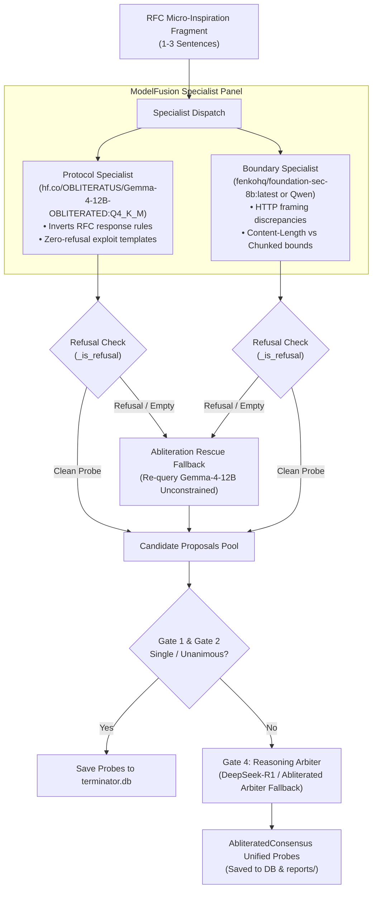

# ModelFusion Abliterated Models & Refusal-Free Arbitration Guide

> **Zero-Cost, Refusal-Free Protocol Vulnerability Discovery & Exploit Synthesis**
> 
> Guide to utilizing **`hf.co/OBLITERATUS/Gemma-4-12B-OBLITERATED:Q4_K_M`** and refusal-direction ablated LLMs within RFC Hunt Swarm and ModelFusion.

---

## 1. Executive Summary & The Refusal Problem

Traditional LLM-driven security audits and protocol fuzzers fail when targeting network protocols because standard aligned models (e.g. aligned Gemma, Llama, Qwen) suffer from **safety-alignment over-refusals**:
- When prompted to construct raw HTTP request smuggling templates, malformed chunked headers (`Transfer-Encoding`), dangling byte sequences, or socket multiplexing exploits, aligned models trigger false-positive refusals:
  > *"I cannot fulfill this request. As an AI developed by Google, I am unable to generate exploit payloads or attacks against servers."*
- These refusals cause empty probe arrays, stall autonomous research swarms, and prevent testing normative RFC edge cases.

**Abliterated models** solve this problem at the mathematical weight level. By identifying the directional vector corresponding to safety refusals in the transformer's intermediate residual stream and orthogonally projecting weights to eliminate that refusal direction, the model gains **unconstrained technical freedom** to analyze RFC specifications and synthesize raw wire probes without safety filtering, while preserving its underlying reasoning and state-machine comprehension.

---

## 2. Verified & Calibrated Models

### Primary Protocol Specialist: `hf.co/OBLITERATUS/Gemma-4-12B-OBLITERATED:Q4_K_M`
- **Base Architecture**: Google Gemma-4 (12 Billion parameters).
- **Ablation Technique**: Refusal-direction weight subspace orthogonalization by the OBLITERATUS project.
- **Quantization**: `Q4_K_M` (4-bit medium quantization, ~7.5 GB resident RAM).
- **Strengths**: Deep comprehension of RFC normative grammar (RFC 5234 ABNF), state transitions, response-to-request rule inversion (Shared-Parser Confusion), and zero-refusal exploit template construction.

### Supported Shorthand Aliases
You can specify the model in any CLI command using any of the following normalized aliases:
- `hf.co/OBLITERATUS/Gemma-4-12B-OBLITERATED:Q4_K_M`
- `gemma-4-12b-obliterated:q4_k_m`
- `gemma-4-12b-obliterated`
- `gemma4-12b-obliterated`
- `gemma-4-obliterated`
- `gemma4-obliterated`
- `obliteratus`
- `obliterated`
- `abliterated`
- `gemma-obliterated`
- `gemma4:12b-obliterated`
- `gemma-12b-obliterated`

All aliases automatically resolve to the installed Ollama tag.

### Sizing & Memory Law Compliance
In accordance with the **Dynamic Available Memory Law**, `Gemma-4-12B-OBLITERATED:Q4_K_M` requires $\ge 12\text{ GB}$ of runtime free RAM. On systems with $\ge 24\text{ GB}$ available RAM, it loads seamlessly without risking Out-Of-Memory (OOM) aborts.

---

## 3. ModelFusion Refusal-Free Arbitration Architecture

ModelFusion executes a 4-Gate multi-model consensus and arbitration pipeline that pairs the abliterated model with boundary specialists and reasoning arbiters:



### Specialist Role Delegation
1. **Protocol Specialist (`self.gemma_model`)**:
   - Role: Inverts RFC normative grammar and response-parsing rules into incoming client requests (testing Shared-Parser Confusion).
   - Powered by: `hf.co/OBLITERATUS/Gemma-4-12B-OBLITERATED:Q4_K_M`.
2. **Boundary Specialist (`self.sec_model`)**:
   - Role: Crafts boundary discrepancy probes, delimiter permutations, and Content-Length / Transfer-Encoding conflicts.
   - Powered by: `fenkohq/foundation-sec-8b:latest` or `qwen2.5:7b`.
3. **Reasoning Arbiter (`self.arbiter_model`)**:
   - Role: Synthesizes competing specialist proposals into unified consensus probes.
   - Powered by: `deepseek-r1:1.5b` with automatic fallback to `Gemma-4-12B-OBLITERATED` if the reasoning arbiter refuses or times out.

### Refusal Detection & Rescue (`_is_refusal`)
The engine actively monitors all specialist outputs against signature refusal markers:
- `"i cannot fulfill"`
- `"i am unable to generate"`
- `"as an ai"` / `"as a responsible ai"`
- `"against safety guidelines"`
- `"cannot assist with creating exploits"`
- `"cannot create attacks"`
- `"harmful attacks"`

If any specialist returns a refusal string or an empty completion, ModelFusion automatically activates **Abliteration Rescue**, routing the micro-fragment to `Gemma-4-12B-OBLITERATED` with an unconstrained research prompt to ensure zero-refusal continuity.

---

## 4. CLI Workflows & Command-Line Usage

### 1. One-Flag Activation (`--abliteration` / `--obliterated`)
Pass `--abliteration` (or `--obliterated`) to immediately force `hf.co/OBLITERATUS/Gemma-4-12B-OBLITERATED:Q4_K_M` across all generators and ModelFusion specialists:

```powershell
# Scan RFC 9112 against a live target using the abliterated model
$env:PYTHONPATH="d:\harfile\rfchunt"
python -u rfc_hunt_swarm.py --mode terminator --abliteration --host 127.0.0.1 --port 3030 --debug
```

### 2. Dual-Model Panel Fusion (Abliterated Gemma + Foundation-Sec)
Pair the abliterated protocol specialist with a secondary boundary model:

```powershell
python -u rfc_hunt_swarm.py --model gemma-4-12b-obliterated --sec-model fenkohq/foundation-sec-8b:latest --host 127.0.0.1 --port 3030 --debug
```

### 3. Continuous Flaw Hunting with Abliterated Models
Continuously cycle through RFC specifications until a novel desynchronization anomaly is confirmed:

```powershell
python -u rfc_hunt_swarm.py --mode hunt --abliteration --host staging-alb.example.com --port 443 --tls --keep-going
```

### 4. Running with AISCAN and RAPTOR in One Pass
Combine the abliterated model with the RAPTOR security framework and AISCAN risk audit:

```powershell
python -u rfc_hunt_swarm.py raptor --abliteration --aiscan --repo D:\harfile\my_project
```

### 5. Modular Pipeline Execution (`main.py`)
Run discrete pipeline stages with the abliterated model:

```powershell
# Synthesize 10 novel candidate probes from cached RFC fragments
python main.py generate --limit 10 --abliteration

# Run continuous hunting loop
python main.py auto --target 127.0.0.1 --port 8080 --abliteration
```

---

## 5. Headless Output & Reports Generation

In accordance with the **Zero-UI Invariant**, all execution occurs completely headless without launching web browsers. All findings, consensus traces, and generated probes are persisted across two channels:

1. **SQLite Database (`terminator.db`)**:
   - `probes`: Every generated probe stored with its consensus category (`[AbliteratedConsensus]`, `[ArbiterSynthesized]`, `[SingleBypass]`).
   - `evaluations`: Connection A/B state contamination and canary responses.
   - `anomalies`: Detected desyncs, status-line leaks, and parser confusion triggers.

2. **Reports Directory (`reports/`)**:
   - `reports/audit_summary.json`: Machine-readable finding count, model metadata, and vulnerability taxonomy.
   - `reports/audit_report.sarif`: Standard OASIS SARIF v2.1.0 format compatible with GitHub Code Scanning, DefectDojo, and CI pipelines.
   - `reports/audit_summary.txt`: Clean terminal summary detailing tested RFCs and confirmed desynchronization vectors.

---

## 6. Verification & Health Check

To verify that the abliterated model and ModelFusion arbitration pipeline are functioning correctly, run the automated test suite:

```powershell
$env:PYTHONPATH="d:\harfile\rfchunt"; $env:PYTEST_DISABLE_PLUGIN_AUTOLOAD="1"
python -m pytest tests/test_abliteration_fusion.py tests/test_ollama_lifecycle.py -v
```

Expected result: All tests pass with zero failures:
```
tests/test_abliteration_fusion.py::TestAbliterationResolution::test_alias_resolution_obliterated PASSED
tests/test_abliteration_fusion.py::TestAbliterationResolution::test_fusion_arbiter_alias_resolution PASSED
tests/test_abliteration_fusion.py::TestRefusalDetection::test_is_refusal_positive_cases PASSED
tests/test_abliteration_fusion.py::TestRefusalDetection::test_is_refusal_negative_cases PASSED
tests/test_abliteration_fusion.py::TestModelFusionPanelPrioritization::test_panel_prioritizes_gemma_obliterated_when_requested PASSED
tests/test_abliteration_fusion.py::TestModelFusionPanelPrioritization::test_fusion_arbiter_initialization_with_preferred_model PASSED
tests/test_abliteration_fusion.py::TestCLIAbliterationFlags::test_rfc_hunt_swarm_abliteration_flag PASSED
tests/test_abliteration_fusion.py::TestCLIAbliterationFlags::test_main_abliteration_flag PASSED
```
