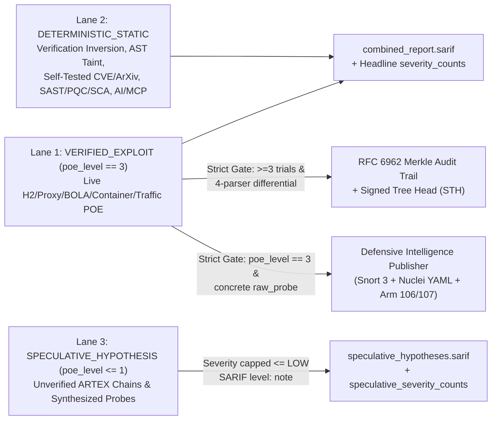

# Master Scorecard: Standalone Tools vs. RFCHunt (`--all` + `--serve-ui`)

This document details how RFCHunt compares against each standalone security and protocol-research tool in its ecosystem, the concrete implementation behind each capability row, and the **Strict 3-Lane Operational Rigor Architecture** that prevents speculative correlations from diluting deterministic static or live-verified signal.

---

## 1. Master Capability Scorecard

| Capability | `aiscan` alone | `RAPTOR` alone | `ARTEX` alone | `Mantis` alone | `Smuggler` / `Nuclei` alone | **RFCHunt (`--all` + `--serve-ui`)** | Primary Implementation |
| :--- | :---: | :---: | :---: | :---: | :---: | :--- | :--- |
| **1. AI / Prompt / MCP Poisoning & Unicode Smuggling** | Yes | Partial | No | Partial | No | **Yes (Native + Rust + Unicode BiDi/Tag + MCP Shadowing + Polyglot Routes)** | `engine/aiscan_integrator.py` |
| **2. SAST + PQC Crypto Readiness + Multi-Ecosystem SCA** | No | Yes | No | Partial | No | **Yes (Native + Docker RAPTOR + NIST FIPS 203/204/205 Score + CVE Range SCA)** | `engine/raptor_integrator.py`, `engine/mantis_integrator.py` |
| **3. 6-Pass Verification Inversion Hunting** | No | No | No | No | No | **Yes (`0` FP on `sandbox-runtime`, Formal Invariants + Witness Traces)** | `engine/verification_inversion_hunter.py` |
| **4. Live 30-Day CVE + ArXiv AST Rule Compiler** | No | No | No | No | No | **Yes (5 Structural Templates + Python AST Def-Use Taint + 3-Way Self-Test Gate)** | `engine/structural_detector_compiler.py`, `engine/arxiv_security_bridge.py`, `engine/last30days_security_skills.py` |
| **5. Enterprise-Safe Live Proxy Smuggling Fuzz** | No | No | No | No | Partial (Unsafe) | **Yes (`--allow-repo-exec` Opt-In + Env-Scrubbed + Ephemeral Sink Telemetry)** | `engine/deep_repo_audit.py` |
| **6. Dual-Graph Multi-Hop Chaining + POE** | No | No | Yes | No | No | **Yes (Cross-Layer Wire + Code + AI + Default 3-Lane Isolation)** | `engine/dual_graph_engine.py`, `engine/artex_bridge.py` |
| **7. 4-Parser Differential Oracle + Merkle Proof** | No | No | No | No | No | **Yes (RFC 6962 Verified + Signed Tree Head + Consistency Proofs)** | `engine/differential_oracle.py`, `engine/merkle_audit.py` |
| **8. Auto-Generated Patch + Snort 3 / Nuclei / Caldera** | No | Partial | No | Prompt only | No | **Yes (Verified-Only Gate: AST Patches + Snort 3 + Nuclei YAML + Caldera)** | `engine/defensive_publisher.py`, `engine/caldera_bridge.py`, `engine/code_verification_repair.py` |
| **9. Self-Hosted Full-Lifecycle GUI & Network Orchestration** | No | No | Yes | No | No | **Yes (`--serve-ui` Loopback SPA + Authenticated REST/SSE + `--network-lifecycle`)** | `engine/mission_control_server.py` |

---

## 2. Operational Rigor: Strict 3-Lane Evidence Separation

Combining broad passive correlation graphs (such as multi-hop Dual-Graph chaining) with deterministic AST passes can inflate severity counts if speculative paths (`poe_level <= 1`) are merged into verified findings. RFCHunt eliminates this trade-off **by default** across every `--all` scan and Mission Control UI session:



### Mandatory Non-Inflation & Gating Invariants
1. **Zero Speculative Severity Inflation**:
   - Unverified multi-hop ARTEX chains (`poe_level <= 1`) and synthesized PromptSmuggler probes (`poe_level == 1`) have reported `severity` capped at `"LOW"` (`"INFO"` for `poe_level == 0`), while preserving their theoretical blast radius under `"potential_impact"`.
   - In SARIF 2.1.0, `SPECULATIVE_HYPOTHESIS` items are always emitted with `"level": "note"` (never `"error"` or `"warning"`) and isolated in `speculative_hypotheses.sarif`.
2. **Zero Cross-Lane Deduplication Contamination**:
   - Speculative hypotheses can never overwrite or raise the `severity`, `poe_level`, or `finding_tier` of any `DETERMINISTIC_STATIC` or `VERIFIED_EXPLOIT` finding during cross-engine deduplication.
3. **Verified-Only RFC 6962 Merkle Audit Gate**:
   - `MerkleAuditTrail` in `--all` only records genuine `>= 3`-trial multi-parser differential wire findings — never fabricated trials or `poe_level == 1` passive correlations.
   - Static-only audits record a separate `static_findings_sha256` manifest digest while reporting `total_leaves: 0` (`status: "no_live_differential_wire_findings"`).
4. **Verified-Only Defensive Signature Gate**:
   - `DefensiveIntelligencePublisher` only generates Snort 3 IDS rules, Nuclei YAML templates, and Arm 106/107 regression tests from `VERIFIED_EXPLOIT` (`poe_level == 3`) findings backed by a concrete `raw_probe` wire payload (`status: "skipped_no_verified_wire_exploits"` on static-only scans).

---

## 3. Quick-Start Commands

### Enterprise-Safe Deterministic Repository Audit (Default Strict 3-Lane Precision)
```powershell
python rfc_hunt_swarm.py --all /path/to/repo --reseach-num 5 --skills-num 5
```

### Self-Hosted Interactive Mission Control GUI & REST/SSE Orchestrator
```powershell
python rfc_hunt_swarm.py --serve-ui --ui-port 8789
```
- Binds strictly to loopback `127.0.0.1:8789` with per-session cryptographic `X-RFCHunt-Token` authentication, `Host`/`Origin` DNS-rebinding checks, and live SSE streaming (`/api/events`).

### Turnkey Multi-Target Network Lifecycle Orchestration (Authorized Targets Only)
```powershell
python rfc_hunt_swarm.py --network-lifecycle --target https://authorized.example.test --authorized
```

### Opt-In Enterprise-Isolated Live Proxy Smuggling Fuzzing
```powershell
python rfc_hunt_swarm.py --deep-audit /path/to/proxy-repo --allow-repo-exec
```
- Executes inside an isolated empty temporary working directory with a scrubbed enterprise environment (`NO_PROXY="*"`, zero inherited credentials) and an ephemeral loopback sink telemetry listener (`127.0.0.1:<ephemeral_port>`).

### HackerOne Campaign Finder & HITL Computer-Use Report Porter (`--hackerone`)
```powershell
# Prepare redacted HackerOne drafts (strictly Lane 1 + Lane 2; zero Lane 3 AI slop)
python rfc_hunt_swarm.py --all /path/to/repo --hackerone --hackerone-program anthropic-vdp

# Launch visible HITL Computer-Use Playwright browser session (human completes login/2FA/CAPTCHA; auto-fills report; stops before Submit)
python rfc_hunt_swarm.py --hackerone --hackerone-program anthropic-vdp --hackerone-browser

# Search live HackerOne campaigns via official API v1 (requires HACKERONE_API_USERNAME + HACKERONE_API_TOKEN in .env)
python rfc_hunt_swarm.py --hackerone --hackerone-api --hackerone-query anthropic --hackerone-bounties-only
```
